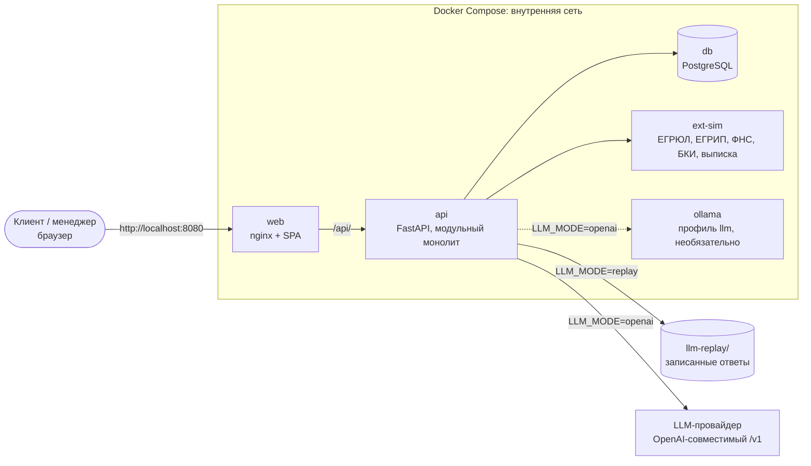

# Архитектура CreditFlow

> Черновик. Источник правды — [design.md](design.md); здесь — схемы и привязка к коду. Решения и их обоснования — design.md §3.2, §3.8.

## Контейнеры

Модульный монолит на FastAPI, отдельный симулятор внешних систем и SPA за nginx на одном origin с API (design.md §3.2).



| Контейнер | Наружу | Код |
| --- | --- | --- |
| `web` | `8080` | `web/`, `web/nginx.conf` |
| `api` | — (в `make dev` — `127.0.0.1:8000`) | `api/` |
| `db` | — (в `make dev` — `127.0.0.1:5432`) | образ `postgres:16-alpine` |
| `ext-sim` | — | `ext-sim/`, контракт — `docs/openapi-ext-sim.json` |
| `ollama` | — | образ `ollama/ollama`, профиль `llm` |

LLM-провайдер — внешний по отношению к compose: облако, vLLM или Ollama. Подключается тремя переменными `LLM_BASE_URL`, `LLM_API_KEY`, `LLM_MODEL` (design.md §3.6).

## Компоненты `api`

Ответственность каждого компонента и то, чего он не делает, — таблица в design.md §3.2. Здесь — где компонент живёт в коде.

| Компонент | Пакет | Состояние |
| --- | --- | --- |
| `AuthService`, `OnboardingService` | `app/auth`, `app/onboarding` | #5 |
| `ApplicationService` | `app/applications` | #7 |
| `ExtSimClient` | `app/extsim_client` | есть |
| `FeatureBuilder`, `RiskEngine`, `DecisionPolicy` | `app/scoring` (чистые функции, `mypy --strict`) | #6 |
| `ManagerService` | `app/manager` | #7 |
| `ContractService` | `app/contracts` | #7 |
| `IdempotencyService` | `app/core/idempotency.py` | #5 |
| `LLMClient` | `app/llm` (`mypy --strict`) | #8 |
| Конфигурация, БД, `GET /api/v1/health` | `app/core` | есть |
| Базовый seed | `app/seed.py` | точка входа есть, данные — #6 |

## Submit

`DRAFT` → `UNDER_REVIEW`, синхронно; семь шагов design.md §3.7. Внешние вызовы идут до транзакции заявки, поэтому сетевые задержки не держат блокировки. Сбой `ext-sim` оставляет заявку в `DRAFT`.

```mermaid
sequenceDiagram
    autonumber
    actor C as Клиент (web)
    participant A as api: ApplicationService
    participant DB as PostgreSQL
    participant X as ExtSimClient → ext-sim
    participant S as scoring
    participant BG as BackgroundTasks → LLMClient

    C->>A: POST /applications/{id}/submit<br/>Idempotency-Key, revision, bki_consent_version
    A->>DB: 1. idempotency_keys IN_PROGRESS (короткая транзакция)
    A->>A: 1. владелец, DRAFT, revision, поля, продукт, версия согласия
    A->>DB: 2. consents (BKI_REQUEST): создать или переиспользовать → consent_id
    par 3. параллельно, только в память
        A->>X: реестр (ЕГРЮЛ / ЕГРИП)
        A->>X: ФНС
        A->>X: БКИ c consent_id
        A->>X: выписка
    end
    alt сбой любого источника
        X-->>A: ProviderUnavailableError
        A->>DB: освободить ключ идемпотентности
        A-->>C: 503 PROVIDER_UNAVAILABLE (заявка в DRAFT, в БД только согласие)
    else все ответы получены
        X-->>A: DTO
        A->>A: 3. категоризация операций (чистая функция)
        A->>DB: 4. BEGIN; SELECT … FOR UPDATE; повторная проверка статуса и revision
        A->>S: 5. FeatureBuilder → inputs_hash → RiskEngine → DecisionPolicy
        S-->>A: расчёт и проект решения
        A->>DB: 6. external_snapshots, account_transactions, scoring_results,<br/>decision_proposals, ai_reports (PENDING), UNDER_REVIEW,<br/>application_events, idempotency_keys (COMPLETED)
        A->>DB: COMMIT
        A-->>C: заявка в UNDER_REVIEW
        A-)BG: 7. генерация AI-заключения для записи PENDING
    end
```

Если процесс упадёт между `COMMIT` и запуском фоновой задачи, запись `PENDING` подхватит восстановление при старте и в периодическом цикле (design.md §3.6).

Конвейер #5–#8 реализован. `ExtSimClient.fetch_all_for_submit(inn, consent_id, period)` опрашивает источники через `asyncio.gather` без частичного сохранения. AI PENDING создаётся в транзакции Submit; HTTP к модели выполняется после COMMIT. Recovery общий с выдачей #7; итог сохраняется условным UPDATE по generation_id. Подробности — [ADR AI-assist](adr/0001-openai-compatible-ai-assist.md).
