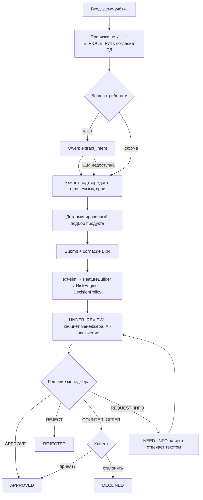
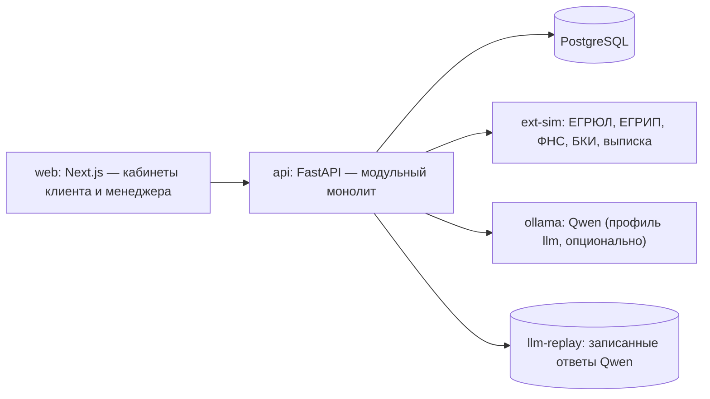
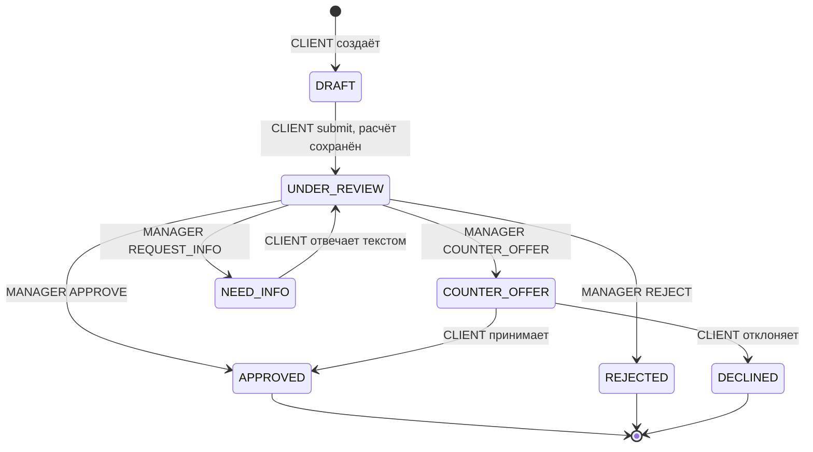

# Proposal: Alfa Smart Credit — MVP кредитного конвейера с AI-assist

Обновлено: 2026-10-21 · Статус: Ready for Implementation · Контекст: хакатон «Умный кредитный кабинет предпринимателя» (Альфа-Банк)

## 1. Abstract

Предпринимателю трудно выбрать кредитный продукт и понять, почему банк отказал или предложил другие условия. Менеджер банка вручную собирает сведения из реестров, БКИ и выписок и сам интерпретирует риски. **Alfa Smart Credit** — веб-продукт из двух кабинетов, клиента и менеджера, где заявка проходит путь от свободного текста предпринимателя до решения менеджера в одном сквозном сценарии на синтетических данных.

Ключевая идея — разделение трёх ролей. **AI-assist** (локальная Qwen) переводит текст клиента в параметры заявки и объясняет менеджеру уже рассчитанные риски. **Объяснимый детерминированный скоринг** на Python выводит признаки из выписки по счёту и считает DSCR, балл и лимит. **Кредитный менеджер** принимает итоговое решение. Инвариант: `LLM ≠ скоринг ≠ кредитное решение`. Без LLM сценарий работает на ручном вводе и шаблонах.

## 2. Background

**Цель MVP.** Один воспроизводимый сценарий: вход → привязка компании по ИНН → потребность → продукт → автоматический сбор данных и расчёт → решение менеджера (`APPROVE`, `COUNTER_OFFER`, `REQUEST_INFO`, `REJECT`) → результат в кабинете клиента.

| Ограничение хакатона | Как выполняется |
|---|---|
| Только веб; весь путь внутри продукта, без email, SMS, звонков и мессенджеров | Next.js, два кабинета; статусы, офферы и дозапросы — только в UI |
| Запуск в Docker на обычном ПК без GPU | `docker compose up --build`; `LLM_MODE=replay` по умолчанию |
| Только LLM с открытыми весами, без платных API | Qwen через Ollama локально; URL LLM ограничен локальными хостами |
| Синтетические данные; внешние системы — локальные моки | Контейнер `ext-sim`: ЕГРЮЛ/ЕГРИП, ФНС, БКИ, банковская выписка |
| Скоринг отделён от решения; исход не бинарный | `scoring_results` → `decision_proposals` → `credit_decisions`; четыре действия менеджера |

Все продукты, ставки, пороги и компании условные. Документ описывает реализацию команды, а не политику Альфа-Банка.

| Роль | Кто | Возможности |
|---|---|---|
| `CLIENT` | Руководитель ЮЛ по ЕГРЮЛ или ИП по ЕГРИП | Привязать компанию, подать заявку, ответить на дозапрос и оффер, видеть статус |
| `MANAGER` | Кредитный менеджер | Единая очередь, анализ заявки, решение, оценка AI-заключения |

**Вне scope:** подписание договора, выдача и графики платежей; лизинг, овердрафт и прочие продукты; ценообразование по риску; изменение срока или продукта в оффере; документы, внешние счета и поручители; LLM-категоризация операций; автоматические решения, включая автоотказ; PD/LGD; реальные интеграции и данные; мобильное приложение; назначение заявок менеджерам.

## 3. Proposal

### 3.1. Сквозной сценарий

1. Вход по демо-учётке физлица (ФИО и персональный ИНН).
2. Привязка компании по ИНН и согласие на обработку ПД; `ext-sim` сверяет пользователя с руководителем (ЕГРЮЛ) или ИП (ЕГРИП).
3. Потребность свободным текстом → Qwen `extract_intent` предзаполняет цель, сумму и срок; либо ручная форма. Клиент подтверждает параметры.
4. Backend детерминированно подбирает продукт из каталога; клиент выбирает продукт и видит платёж.
5. Submit с согласием на запрос в БКИ: `ext-sim` → категоризация выписки → `FeatureBuilder` → `RiskEngine` → `DecisionPolicy` → `UNDER_REVIEW`.
6. Менеджер видит расчёт, проект решения и AI-заключение Qwen (`explain_risk`), оценивает заключение 👍/👎 и выбирает действие.
7. Клиент видит одобрение, отказ с причиной, оффер (принять/отклонить) или вопрос (ответить текстом).



### 3.2. Архитектура и стек

**Модульный монолит** на FastAPI и отдельный контейнер-симулятор внешних систем. Брокеров, фоновых воркеров и очередей нет: все операции синхронные с таймаутами.



| Компонент в `api` | Ответственность | Не делает |
|---|---|---|
| `AuthService` / `OnboardingService` | Demo-auth, привязка по ИНН, проверка полномочий, согласия | Не оценивает кредитоспособность |
| `ApplicationService` | FSM заявки, Submit, сборка входов (`inputs_json`, `inputs_hash`), запись в БД | Не считает метрики, не интерпретирует текст |
| `ExtSimClient` | HTTP-вызовы `ext-sim`: таймаут 3 с, один повтор, разбор в типизированные DTO | Не содержит бизнес-правил |
| `FeatureBuilder` | Чистая функция: категоризация операций по правилам и признаки выписки | Не обращается к сети и БД |
| `RiskEngine` | Чистая функция: платёж, DSCR, scorecard, risk level, коды, лимит | Не знает о стоп-факторах и действиях |
| `DecisionPolicy` | Чистая функция: стоп-факторы, `suggested_action`, `allowed_actions` | Не принимает решение за менеджера |
| `ManagerService` | Проверка и запись решений, офферов, дозапросов, обратной связи по AI | Не обходит `allowed_actions` |
| `LLMAdapter` | Вызов Ollama или replay, JSON-схемы, валидация, шаблонный fallback | Не задаёт числа, статусы и решения |

**Стек:** Next.js + TypeScript (polling статуса каждые 5 с, токен в `sessionStorage`); Python 3.12, FastAPI, Pydantic v2, SQLAlchemy 2, Alembic; PostgreSQL; Ollama + Qwen; Docker Compose (`web`, `api`, `db`, `ext-sim`, `ollama` в профиле `llm`). **Конфигурация (`.env.example`):** `DATABASE_URL`, `APP_SECRET_KEY`, `DEMO_AUTH_ENABLED`, `APP_AS_OF_DATE=2026-10-21`, `EXT_SIM_BASE_URL`, `LLM_MODE`, `LLM_BASE_URL`, `LLM_MODEL`, `LLM_TIMEOUT_SECONDS=30`.

### 3.3. Клиентский кабинет

- **Вход.** `POST /auth/login` → JWT HS256; пароли — argon2. Экран входа показывает демо-учётки (`GET /auth/demo-accounts`, только при `DEMO_AUTH_ENABLED=true`). ИНН компании не служит средством входа.
- **Привязка компании.** `POST /onboarding/company-binding {inn, pd_consent_version}`. 10 цифр → ЕГРЮЛ, 12 → ЕГРИП. Полномочия: ИНН **и** нормализованное ФИО (NFC, `ё→е`, нижний регистр, схлопнутые пробелы) руководителя или ИП совпадают с учёткой. Иначе `403 APPLICANT_NOT_AUTHORIZED`; компании нет в реестре — `422 COMPANY_NOT_IN_REGISTRY`. Один клиент — одна компания.
- **Заявка.** Поля черновика: `purpose_code` (`EQUIPMENT`, `RENOVATION`, `BUSINESS_EXPANSION`, `INVENTORY`, `SUPPLIERS`, `WORKING_CAPITAL`), `requested_amount_rub` (целые рубли), `term_months`, `product_id`, `purpose_text`. Единственный источник истины — `PATCH /applications/{id}`.
- **AI-распознавание.** `POST /applications/{id}/interpret {purpose_text}` возвращает `{status: OK | NEEDS_CLARIFICATION | UNAVAILABLE, suggestion, clarification_question}` и **не меняет заявку**. Поля формы помечаются «предложено ИИ» и сохраняются только после «Подтвердить» (`terms_source = LLM_CONFIRMED`). При `UNAVAILABLE` показывается баннер, ручная форма остаётся доступной (`terms_source = MANUAL`).
- **Выбор продукта.** `GET /credit-products?purpose=&amount=&term=`: продукт подходит, если цель входит в `allowed_purposes`, а сумма и срок — в его пределы. Ответ содержит ежемесячный платёж и оговорку «не является решением». Подходящих нет — указывается, какое ограничение не выполнено.

| `product_id` | Продукт (демо) | Цели | Сумма | Срок | Ставка |
|---|---|---|---|---|---|
| `investment` | Инвестиционный кредит | `EQUIPMENT`, `RENOVATION`, `BUSINESS_EXPANSION` | 100 тыс. – 5 млн ₽ | 12–60 мес. | 24% |
| `working_capital` | Оборотный кредит | `INVENTORY`, `SUPPLIERS`, `WORKING_CAPITAL` | 100 тыс. – 3 млн ₽ | 3–24 мес. | 24% |

- **Отправка.** `POST /applications/{id}/submit {revision, bki_consent_version}`: чекбокс согласия на запрос в БКИ обязателен и не отмечен по умолчанию.
- **Статусы.** Таймлайн из `application_events`; причина отказа — шаблонный текст по `client_reason_code`.
- **Встречное предложение.** Карточка «Вы просили → Банк предлагает»: сумма, срок, ставка, платёж. Действия `POST /applications/{id}/offer/accept` и `/offer/decline`.
- **Дозапрос.** Вопрос менеджера и ответ текстом ≤ 2000 символов: `POST /applications/{id}/info-response {revision, answer_text}`.
- **Не показывается клиенту ни до, ни после решения:** score, DSCR, лимит, коды, проект решения, AI-заключение, комментарий менеджера.

### 3.4. Финансовый конвейер

**Синтетические источники `ext-sim`.** Ответы детерминированы и берутся из фикстур по ИНН (`ext-sim/fixtures/`). Выписки сгенерированы скриптом seed с фиксированным seed и закоммичены. Для тестов отказов служит заголовок `X-Sim-Fail`.

| Endpoint | Данные | Используется для |
|---|---|---|
| `GET /egrul/v1/companies/{inn}`, `GET /egrip/v1/entrepreneurs/{inn}` | Статус `ACTIVE`/`LIQUIDATING`/`LIQUIDATED`, дата регистрации, ОКВЭД, руководитель или ИП (ФИО, ИНН); `404` — нет в реестре | Полномочия, возраст бизнеса, стоп-фактор |
| `GET /fns/v1/companies/{inn}` | `bankruptcy`, число действующих блокировок счетов | Стоп-факторы |
| `POST /bki/v1/reports {inn, consent_id}` | `summary_status` (`CLEAN`/`UNKNOWN`/`MINOR`/`SERIOUS`), `monthly_payments_total_rub`; без `consent_id` → `403` | Фактор скоринга, R2, долговая нагрузка |
| `GET /bank/v1/statements?inn=&from=&to=` | Операции: дата, `IN`/`OUT`, сумма, контрагент (ИНН, имя, `is_bank`), назначение | `FeatureBuilder` |

**Категоризация (только RULE).** Словарь `rules/categorization-v1.yaml`, побеждает первое сработавшее правило. Категория и `rule_id` пишутся в `account_transactions`.

| Порядок | Условие | Категория | Группа |
|---|---|---|---|
| 1 | ИНН контрагента = ИНН компании | `OWN_TRANSFER` | исключается |
| 2 | OUT банку, назначение ~ `погашени\|кредитн\|процент` | `LOAN_REPAYMENT` | `debt_svc` |
| 3 | IN от банка, назначение ~ `выдач\|предоставлени.*кредит` | `LOAN_PROCEEDS` | не выручка |
| 4 | OUT: КБК `182…` / `заработн` / `аренд` / `снятие наличн` / ИНН руководителя | `TAX` / `SALARY` / `RENT` / `CASH_WITHDRAWAL` / `OWNER_TRANSFER` | `opex` |
| 5 | IN от банка ~ `эквайринг`; IN от ЮЛ/ИП ~ `оплат\|по счет\|за товар\|за услуг` | `ACQUIRING` / `CUSTOMER_PAYMENT` | `revenue` |
| 6 | OUT ЮЛ/ИП ~ `оплат\|поставк\|за товар` | `SUPPLIER` | `opex` |
| — | иначе | `UNCLASSIFIED` | IN — не выручка, OUT — `opex` (консервативно) |

**FeatureBuilder** (чистая функция на `Decimal`). Окно — 12 полных месяцев до месяца `as_of_date`. `h` — число месяцев от первой операции до конца окна (≤ 12), `k = ⌊h/2⌋`.

```text
revenue[m]   = Σ IN  {CUSTOMER_PAYMENT, ACQUIRING}
opex[m]      = Σ OUT {SUPPLIER, SALARY, TAX, RENT, CASH_WITHDRAWAL, OWNER_TRANSFER, UNCLASSIFIED}
debt_svc[m]  = Σ OUT {LOAN_REPAYMENT}
cfads_monthly_rub          = median(revenue[m] − opex[m]) за последние min(6, h) мес.
revenue_change_pct         = (Σ revenue[последние k] / Σ revenue[предыдущие k] − 1) · 100
existing_debt_payments_rub = max(mean(debt_svc[m]) за последние 3 мес., БКИ.monthly_payments_total_rub)
business_age_months        = полные месяцы от даты регистрации до as_of_date
```

Если `h < 6` или `Σ revenue[предыдущие k] = 0`, признаки недостаточны: расчёт пропускается (`calculation_status = SKIPPED`), срабатывает стоп-фактор `ACCOUNT_HISTORY_INSUFFICIENT`.

**RiskEngine** (`r` — ставка продукта, `S` — сумма, `n` — срок, целевой DSCR 1.25):

```text
r = rate / 1200;  A(r, n) = 1/n при r = 0, иначе r / (1 − (1 + r)^−n);  P = S · A(r, n)
DSCR      = cfads_monthly_rub / (existing_debt_payments_rub + P)
P_max     = max(0, cfads_monthly_rub / 1.25 − existing_debt_payments_rub)
limit_rub = ⌊min(P_max / A(r, n), product.max_amount) / 10 000⌋ · 10 000;  null, если < product.min_amount
```

| Фактор | Условие → баллы | Max |
|---|---|---:|
| DSCR | ≥ 1.50 → 40 · ≥ 1.25 → 30 · ≥ 1.00 → 10 · < 1.00 → 0 | 40 |
| Кредитная история (БКИ) | `CLEAN` → 30 · `UNKNOWN` → 15 · `MINOR` → 10 · `SERIOUS` → 0 | 30 |
| Динамика выручки | ≥ 0% → 15 · [−15%; 0%) → 8 · < −15% → 0 | 15 |
| Возраст бизнеса | ≥ 24 мес. → 15 · 12–23 → 8 · < 12 → 0 | 15 |

`score = Σ`. Risk level: 80–100 `LOW`, 60–79 `MODERATE`, 40–59 `HIGH`, < 40 `VERY_HIGH`; при `DSCR < 1.00` уровень не ниже `HIGH`. Это словесная категория, а не PD. Каждый фактор даёт код из реестра: риск-коды (`DSCR_BELOW_ONE`, `DSCR_BELOW_TARGET`, `CREDIT_HISTORY_SERIOUS/MINOR/UNKNOWN`, `REVENUE_DECLINE`, `REVENUE_SHARP_DECLINE`, `YOUNG_BUSINESS`) и плюс-коды (`DSCR_MEETS_TARGET`, `CLEAN_CREDIT_HISTORY`, `REVENUE_STABLE_OR_GROWING`, `ESTABLISHED_BUSINESS`).

**Денежные правила.** `Decimal` с `prec = 34`; деньги — `NUMERIC(15,2)`, DSCR — `NUMERIC` без масштаба; `float` запрещён; в API деньги и DSCR передаются строками. Пороги сравниваются по неокруглённым значениям. Платёж хранится и показывается с `ROUND_HALF_UP` до копеек, но DSCR и лимит считаются от неокруглённого `P`. DSCR показывается с 2 знаками через `ROUND_DOWN` (`1.2487…` → `1.24`, не `1.25`). Лимит округляется вниз до 10 000 ₽. При ставке 0% `P = S/n`. Сумма ≤ 0 или дробная, сумма и срок вне продукта → `422` на API и `ValueError` в движке.

**DecisionPolicy** — правила по порядку; первое сработавшее задаёт `suggested_action`, все правила пишутся в `rule_trace`.

| # | Условие | `suggested_action` |
|---|---|---|
| R1 | `blocking_codes ≠ ∅` (таблица ниже) | `BLOCKED_BY_RULE` |
| R2 | БКИ `SERIOUS` | `MANUAL_REVIEW` |
| R3 | `DSCR < 1.25` и `limit_rub ≠ null` | `COUNTER_OFFER_CANDIDATE` |
| R4 | `DSCR ≥ 1.25` и `score ≥ 80` | `ELIGIBLE_FOR_MANAGER_REVIEW` |
| R5 | Иначе | `MANUAL_REVIEW` |

| Стоп-фактор | Источник и условие | `client_reason_code` |
|---|---|---|
| `COMPANY_INACTIVE` | ЕГРЮЛ/ЕГРИП: `LIQUIDATING` или `LIQUIDATED` | `COMPANY_STATUS` |
| `APPLICANT_NOT_AUTHORIZED` | Повторная сверка руководителя при Submit | `APPLICANT_NOT_AUTHORIZED` |
| `BANKRUPTCY_PROCEEDING` | ФНС: `bankruptcy = true` | `COMPANY_STATUS` |
| `ACCOUNT_BLOCKED_BY_FNS` | ФНС: действующие блокировки > 0 | `TAX_AUTHORITY_RESTRICTIONS` |
| `ACCOUNT_HISTORY_INSUFFICIENT` | Выписка: `h < 6` или нулевая база выручки | `INSUFFICIENT_DATA` |

**Пример — «Пекарня Плюс»** (`investment`, 3 000 000 ₽ / 36 мес. / 24%). По выписке `cfads = 240 000` (медиана `(238 000 + 242 000) / 2`), долг по выписке и БКИ 100 000, выручка −8%, возраст 36 мес., БКИ `CLEAN`. `P = 117 698,56`, DSCR `1.1024…` (показ 1.10). Баллы `10 + 30 + 8 + 15 = 63` → `MODERATE`. `P_max = 92 000`, `limit_rub = 2 340 000`. Итог — `COUNTER_OFFER_CANDIDATE`. На 2 340 000 ₽: `P = 91 804,88`, DSCR `1.2512…`, score 83, `LOW`.

### 3.5. Кабинет менеджера

- **Очередь** `GET /manager/applications?status=`: все заявки, сортировка по `submitted_at`, колонка `suggested_action`.
- **Карточка** `GET /manager/applications/{id}`: реестр, ФНС и БКИ с указанием источника; признаки выписки с помесячным рядом; платёж, DSCR, score с разбивкой по факторам, risk level, коды, лимит; проект решения (`suggested_action`, `blocking_codes`, `rule_trace`); AI-заключение; ответы клиента на дозапросы; `allowed_actions`.
- **Действия.** `POST /manager/applications/{id}/decisions` допустим только в статусе `UNDER_REVIEW` при совпадении `revision`. `allowed_actions` вычисляет одна функция `DecisionPolicy` и для `GET`, и для `POST`.

| Действие | Когда разрешено | Обязательные поля | Результат |
|---|---|---|---|
| `APPROVE` | `blocking_codes = ∅` | `comment` (если `suggested_action ≠ ELIGIBLE…`, комментарий обосновывает отклонение от рекомендации) | `APPROVED` |
| `COUNTER_OFFER` | `blocking_codes = ∅`, `limit_rub ≠ null` | `amount_rub`: `product.min ≤ amount ≤ limit_rub`, `amount < requested`; `client_reason_code`, `comment` | `COUNTER_OFFER`; оффер с собственным расчётом (`kind = COUNTER_OFFER`) на тех же входах, срок и продукт прежние |
| `REQUEST_INFO` | `blocking_codes = ∅` | `question_text` ≤ 1000 | `NEED_INFO` |
| `REJECT` | Всегда | `client_reason_code`, `comment` | `REJECTED` |

- **Обратная связь по AI.** На AI-заключении кнопки 👍/👎 и необязательный комментарий: `POST /manager/applications/{id}/ai-feedback {ai_report_id, verdict: UP | DOWN, comment?}`. Повторная оценка того же менеджера заменяет предыдущую. Оценка не влияет на статус, расчёт и доступные действия.

### 3.6. AI-assist

| Задача | Вызов | Вход | Выход (JSON Schema, `additionalProperties: false`) | Fallback |
|---|---|---|---|---|
| `extract_intent` | Синхронно из `/interpret` | `purpose_text` как недоверенный текст, список enum целей | `{purpose_code \| null, requested_amount_rub \| null, term_months \| null, clarification_question \| null}`; невалидное поле → `null` | `status: UNAVAILABLE`, ручная форма |
| `explain_risk` | Синхронно из `POST /manager/applications/{id}/ai-report` (UI вызывает при открытии карточки; `?regenerate=true` — новая версия) | Агрегаты и коды текущего расчёта в формате показа, условия заявки, текст клиента в поле `client_text_untrusted` | `{summary ≤ 600, risk_factors[{code, text}], positive_factors[{code, text}], manager_questions[≤ 3]}` | Шаблон по кодам с числами из расчёта |

- **Валидация.** Строгая схема; коды ⊆ кодов расчёта, и каждый риск-код покрыт; каждое число в тексте совпадает с переданным значением (белый список); запрещены обещания решения (`/одобр/`, `/гарантир/`). Нарушение → 1 повтор → шаблон.
- **Запреты.** Qwen не считает, не меняет и не придумывает числа, не выбирает продукт, ставку или действие, не инициирует переходов статусов. Все показываемые числа берутся из БД.
- **Статусы `ai_reports`:** `READY` (ответ прошёл валидацию) или `FALLBACK` с `fallback_reason` (`DISABLED`, `TIMEOUT`, `UNAVAILABLE`, `INVALID_OUTPUT`, `REPLAY_MISS`). Решение менеджера от отчёта не зависит.
- **Режимы `LLM_MODE`:** `ollama` — живая модель; `replay` (по умолчанию) — ответ из фикстуры `llm-replay/{task}/{prompt_version}/{context_hash}.json`, записанной на реальной Qwen командой `make llm-record`; `disabled` — только шаблоны. Replay-ответы проходят те же валидаторы; `APP_AS_OF_DATE` фиксирует дату, чтобы контексты совпадали.
- **Модель:** Qwen3-4B-Instruct, Q4_K_M, CPU, 8 ГБ ОЗУ; `temperature = 0`, фиксированный `seed`, structured output Ollama. Тег, digest и лицензия (ожидается Apache-2.0, сверяется по model card) фиксируются в `THIRD_PARTY_NOTICES`.
- **Клиентские тексты** — шаблоны по `action` и `client_reason_code`; LLM для клиента не используется.

### 3.7. Статусы и API



Остальные переходы → `409 INVALID_STATUS_TRANSITION`. Ответ на дозапрос не меняет данные расчёта, поэтому повторного скоринга нет. При принятии оффера сумма заявки и текущий расчёт заменяются оффером.

**Submit** (`DRAFT` → `UNDER_REVIEW`, синхронно):

1. Проверки: владелец заявки, статус `DRAFT`, `revision`, поля заполнены, продукт подходит, согласие БКИ → `consents`.
2. **Вне транзакции:** `ext-sim` (реестр, ФНС, БКИ, выписка) → `external_snapshots`, `account_transactions` с категориями. Сбой → `503 PROVIDER_UNAVAILABLE`, заявка не меняется.
3. `BEGIN`; `SELECT … FOR UPDATE`; повторная проверка статуса и `revision`.
4. `FeatureBuilder` → входы и `inputs_hash` → `RiskEngine` → `DecisionPolicy`.
5. Вставка `scoring_results` и `decision_proposals`; `status = UNDER_REVIEW`, `revision += 1`; событие в `application_events`; `COMMIT`.

**Модель данных.** UUID, `timestamptz` UTC. `scoring_results`, `decision_proposals`, `credit_decisions`, `external_snapshots` только вставляются; пересчёт создаёт новую запись.

| Таблица | Ключевые поля |
|---|---|
| `users` | `id`, `role`, `email`, `password_hash`, `full_name`, `person_inn`, `company_id?` |
| `companies` | `id`, `inn` (unique), `legal_form` (`LLC`/`IE`), `name`, `okved_main`, `registered_at` |
| `consents` | `id`, `user_id`, `company_id`, `application_id?`, `type` (`PD_PROCESSING`/`BKI_REQUEST`), `text_version`, `granted_at` |
| `external_snapshots` | `id`, `company_id`, `provider` (`EGRUL`/`EGRIP`/`FNS`/`BKI`/`BANK`), `response_json`, `fetched_at` |
| `account_transactions` | `id`, `company_id`, `external_id`, `booked_at`, `direction`, `amount_rub`, `counterparty_inn?`, `counterparty_name`, `is_bank`, `purpose_text`, `category`, `rule_id` |
| `credit_products` | `id`, `name`, `allowed_purposes[]`, `min/max_amount_rub`, `min/max_term_months`, `annual_rate_pct` |
| `applications` | `id`, `company_id`, `owner_user_id`, `status`, `revision`, `purpose_text`, `purpose_code`, `requested_amount_rub`, `term_months`, `product_id`, `terms_source`, `current_scoring_id?`, `submitted_at?` |
| `scoring_results` | `id`, `application_id`, `kind` (`SUBMISSION`/`COUNTER_OFFER`), `inputs_json` (с признаками), `inputs_hash`, `engine_version`, `calculation_status`, `monthly_payment_rub`, `dscr`, `score`, `factor_points_json`, `risk_level`, `reason_codes[]`, `positive_codes[]`, `limit_rub?` |
| `decision_proposals` | `id`, `scoring_result_id` (1:1), `policy_version`, `blocking_codes[]`, `suggested_action`, `rule_trace_json` |
| `credit_decisions` | `id`, `application_id`, `proposal_id`, `manager_user_id`, `action`, `client_reason_code?`, `comment` |
| `offers` | `id`, `decision_id`, `amount_rub`, `term_months`, `product_id`, `annual_rate_pct`, `monthly_payment_rub`, `offer_scoring_id`, `status` (`OPEN`/`ACCEPTED`/`DECLINED`) |
| `info_requests` | `id`, `application_id`, `decision_id`, `question_text`, `answer_text?`, `answered_at?` |
| `ai_reports` | `id`, `application_id`, `scoring_result_id`, `status`, `llm_mode`, `model_id`, `prompt_version`, `context_hash`, `report_json`, `fallback_reason?` |
| `ai_feedback` | `id`, `ai_report_id`, `manager_user_id`, `verdict` (`UP`/`DOWN`), `comment?`; `UNIQUE (ai_report_id, manager_user_id)` |
| `application_events` | `id`, `application_id`, `actor_user_id`, `from_status`, `to_status`, `created_at` |

**API v1** (`/api/v1`, JSON; изменяющие запросы передают `revision`; ошибки `{"error": {"code", "message"}}`):

| Группа | Endpoints |
|---|---|
| Auth | `POST /auth/login`, `GET /auth/me`, `GET /auth/demo-accounts` |
| Онбординг | `GET /consents/texts`, `POST /onboarding/company-binding`, `GET /company` |
| Клиент | `GET /credit-products`, `POST /applications`, `GET /applications`, `GET /applications/{id}`, `PATCH /applications/{id}`, `POST /applications/{id}/interpret`, `POST /applications/{id}/submit`, `POST /applications/{id}/info-response`, `POST /applications/{id}/offer/accept`, `POST /applications/{id}/offer/decline` |
| Менеджер | `GET /manager/applications`, `GET /manager/applications/{id}`, `POST /manager/applications/{id}/decisions`, `POST /manager/applications/{id}/ai-report`, `POST /manager/applications/{id}/ai-feedback` |
| Служебные | `GET /health` → `{db, ext_sim, llm: ok \| replay \| disabled \| unavailable}` |

Коды ответов: `401`/`403` — аутентификация и роль; `404` — чужой или несуществующий объект; `409` — `REVISION_CONFLICT`, `INVALID_STATUS_TRANSITION`; `422` — валидация, `ACTION_NOT_ALLOWED`, `CONSENT_REQUIRED`; `503` — только сбой `ext-sim`. Swagger: `/docs` у `api` и `ext-sim`; экспорт в `docs/openapi.json`, `docs/openapi-ext-sim.json`; коллекция `docs/api-collection.json` по демо-сценариям.

### 3.8. Зафиксированные архитектурные решения

- **Модульный монолит на FastAPI** с синхронной обработкой: без микросервисов, брокеров, воркеров и outbox. Целостность обеспечивает одна транзакция PostgreSQL.
- **Внешние системы заменены отдельным локальным `ext-sim`** с собственным OpenAPI. Вызовы выполняются до транзакции заявки, чтобы сетевые задержки не держали блокировки.
- **Финансовые расчёты детерминированы** (`Decimal`, `APP_AS_OF_DATE`, `inputs_hash`) и выполняются чистыми функциями отдельно от LLM. Признаки выводятся из выписки, а не вводятся вручную.
- **Скоринг и кредитное решение разделены:** `RiskEngine` → `scoring_results`, `DecisionPolicy` → `decision_proposals`, менеджер → `credit_decisions`. Автоматических решений нет; стоп-фактор оставляет менеджеру только `REJECT`.
- **Менеджеры работают с единой очередью** без назначения; одновременные действия разрешаются через `revision` и `FOR UPDATE`. Демо на одном ПК — две вкладки, токен в `sessionStorage`.
- **Для проверки без GPU предусмотрен `LLM_MODE=replay`:** реальные записанные ответы Qwen проходят те же валидаторы.
- **Клиент не видит внутренние значения** score, DSCR и лимита — ни до, ни после решения.
- **Ставка фиксирована каталогом;** менеджер меняет в оффере только сумму в пределах `limit_rub`.
- **Вход — по учётке физлица;** ИНН компании служит только для привязки с проверкой полномочий.
- **Минимальная история по счёту — 6 месяцев:** меньше — стоп-фактор, поскольку CFADS не вычисляется надёжно.
- **`APPROVE` при `DSCR < 1.00` не запрещён** (это не стоп-фактор), но risk level ≥ `HIGH`, `ELIGIBLE` невозможен, а одобрение требует обоснования в комментарии.

## 4. Security & Reliability

- **RBAC.** Роль проверяется на каждом endpoint. Клиент видит только свою компанию (чужие объекты → `404`). Ответы строятся отдельными Pydantic-схемами для клиента и менеджера, а не фильтрацией на frontend.
- **Синтетические данные.** Реальных банковских интеграций нет. `ext-sim` и `ollama` доступны только во внутренней сети compose; `LLM_BASE_URL` допускает лишь `ollama`, `localhost`, `127.0.0.1`. Секреты хранятся в `.env` (в git только `.env.example`); пароли — argon2; пароли, токены и контексты LLM не логируются.
- **Согласия.** ПД — при привязке, БКИ — при Submit; обе версии текста сохраняются в `consents`. Адаптер не вызывает БКИ без `consent_id`, `ext-sim` отвечает `403`.
- **Детерминированность.** Одинаковые входы дают одинаковые `inputs_hash` и результат. Записи расчётов и решений не изменяются.
- **Переходы статусов.** Только через FSM `ApplicationService` в транзакции с `SELECT … FOR UPDATE` и проверкой `revision`. Повторный клик отклоняется как недопустимый переход (`409`). LLM и текст клиента статусы не меняют.
- **Недоступность симуляторов.** Таймаут 3 с, один повтор, затем `503`; заявка остаётся в `DRAFT`, повтор безопасен.
- **Недоступность LLM.** `interpret` → `UNAVAILABLE` и ручная форма; AI-заключение → шаблон `FALLBACK`; backend остаётся healthy.
- **Prompt injection.** Текст клиента передаётся в отдельном поле `*_untrusted`; выход ограничен схемой, enum и белым списком чисел; у LLM нет доступа к БД и инструментам.

## 5. Implementation Plan & Verification

| Этап | Результат |
|---|---|
| 1. Core MVP | Compose (`web`, `api`, `db`, `ext-sim`), миграции, seed, demo-auth, привязка и согласия, ручная форма, Submit-конвейер, категоризация, `FeatureBuilder`, `RiskEngine`, `DecisionPolicy`, оба кабинета, четыре действия, оффер и дозапрос; `LLM_MODE=disabled`; тесты M1–M9 |
| 2. AI Integration | `extract_intent` и `explain_risk` через Ollama, валидаторы, шаблонный fallback, запись replay-фикстур, `LLM_MODE=replay` по умолчанию, 👍/👎 |
| 3. Demo & Delivery | Четыре демо-фикстуры, E2E-тесты (Playwright), экспорт OpenAPI, коллекция запросов, README с demo flow, `THIRD_PARTY_NOTICES`, тег релиза |


**Тесты критических формул** (unit, обязательны):

| # | Вход | Ожидаемо |
|---|---|---|
| M1 | Пекарня, 3 000 000 / 36 / 24% | `P = 117698.56`; DSCR `1.10244…` (показ 1.10); score 63; `limit_rub = 2340000.00` |
| M2 | Пекарня, 2 350 000 / 36 | DSCR `1.24871…` < 1.25 → 10 баллов DSCR; показ `1.24` |
| M3 | Пекарня, 2 340 000 / 36 | `P = 91804.88`; DSCR `1.25127…` → 30 баллов; score 83 `LOW`, `ELIGIBLE` |
| M4 | 0%, 1 200 000 / 12, CFADS 125 000, долг 0 | `P = 100000.00`; DSCR ровно `1.25` → проходит (`≥`) |
| M5 | 0%, 1 200 012 / 12, то же | DSCR `1.2499875` → не проходит; показ `1.24` |
| M6 | 0%, 100 001 / 8 | `P = 12500.125` → `12500.13` (`ROUND_HALF_UP`) |
| M7 | 1 000 000 / 36 / 24%, CFADS 120 000, долг 100 000, `CLEAN`, выручка ≥ 0, 36 мес. | DSCR `0.86186…`; score 60 → итог `HIGH`; `limit_rub = null` → R5 `MANUAL_REVIEW` |
| M8 | `FeatureBuilder` на выписке Пекарни | `cfads = 240000.00`, `revenue_change_pct = −8.00`, долг 100 000; при `h = 5` → `ACCOUNT_HISTORY_INSUFFICIENT` |
| M9 | Сумма ≤ 0 или дробная, срок вне продукта, `float` во входах | `422` / `ValueError` |
