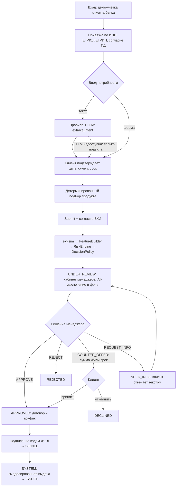
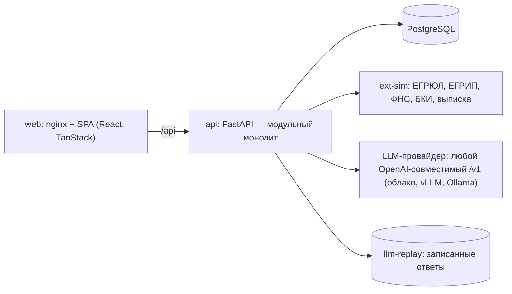
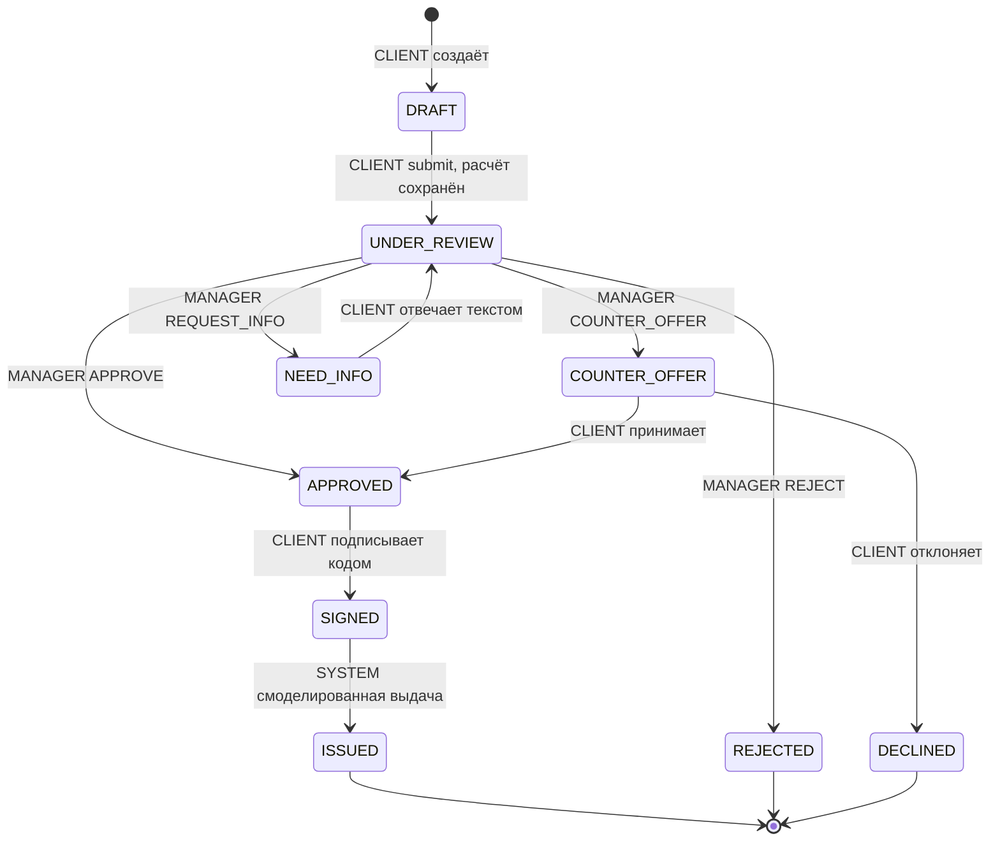

# Proposal: Alfa Smart Credit — MVP кредитного конвейера с AI-assist

Ревизия: **2.5**

Контекст: хакатон «Умный кредитный кабинет предпринимателя» (Альфа-Банк)

## 1. Abstract

Предпринимателю трудно выбрать кредитный продукт и понять, почему банк отказал или предложил другие условия. Менеджер банка вручную собирает сведения из реестров, БКИ и выписок и сам интерпретирует риски. **Alfa Smart Credit** — веб-продукт из двух кабинетов, клиента и менеджера. Заявка действующего клиента банка проходит в нём весь путь: от свободного текста предпринимателя через решение менеджера до подписания договора и смоделированной выдачи. Сценарий один, сквозной, на синтетических данных.

Ключевая идея — разделение трёх ролей:

- **AI-assist** — LLM с открытыми весами через любой OpenAI-совместимый API. Переводит текст клиента в параметры заявки и объясняет менеджеру уже рассчитанные риски.
- **Объяснимый детерминированный скоринг** на Python. Выводит признаки из выписки по счёту и считает DSCR, балл и лимит.
- **Кредитный менеджер.** Принимает итоговое решение.

Инвариант: `LLM ≠ скоринг ≠ кредитное решение`. Без LLM сценарий работает на правилах, ручном вводе и шаблонах.

## 2. Background

**Цель MVP.** Один воспроизводимый сценарий:

1. вход;
2. привязка компании по ИНН;
3. потребность;
4. продукт;
5. автоматический сбор данных и расчёт;
6. решение менеджера (`APPROVE`, `COUNTER_OFFER`, `REQUEST_INFO`, `REJECT`);
7. ответ клиента;
8. договор и график платежей;
9. подписание кодом подтверждения;
10. смоделированная выдача.

Сценарий заканчивается выдачей, посткредитного обслуживания нет.

| Ограничение хакатона | Как выполняется |
|---|---|
| Только веб; весь путь внутри продукта, без email, SMS, звонков и мессенджеров | SPA с двумя кабинетами; статусы, офферы, дозапросы и код подписания — только в UI |
| Запуск в Docker на обычном ПК; проверяющие запускают решение сами | `docker compose up --build`; LLM в обязательный стек не входит; облачный стенд — дополнение |
| LLM только с открытыми весами; провайдер заменяем на проверке | OpenAI-совместимый клиент: `LLM_BASE_URL`, `LLM_API_KEY`, `LLM_MODEL`; провайдер любой (облако, vLLM, Ollama); `LLM_MODE=replay` по умолчанию |
| Синтетические данные; внешние системы — локальные моки | Контейнер `ext-sim`: ЕГРЮЛ/ЕГРИП, ФНС, БКИ, банковская выписка |
| Скоринг отделён от решения; исход не бинарный | `scoring_results` → `decision_proposals` → `credit_decisions`; четыре действия менеджера |
| Подписание и выдача без реальных операций | Простая электронная подпись кодом из UI; выдача — системный переход `SIGNED` → `ISSUED` |

Продукты, компании и пороги условные. Ставки привязаны к ключевой ставке ЦБ на `APP_AS_OF_DATE` (§3.4). Документ описывает реализацию команды, а не политику Альфа-Банка.

| Роль | Кто | Возможности |
|---|---|---|
| `CLIENT` | Руководитель ЮЛ по ЕГРЮЛ или ИП по ЕГРИП — действующий клиент банка | Привязать компанию, подать заявку, ответить на дозапрос и оффер, подписать договор, видеть статус |
| `MANAGER` | Кредитный менеджер | Единая очередь и сводка, анализ заявки, решение, оценка AI-заключения |
| `SYSTEM` | Фоновые задачи `api` | Генерация AI-заключения, смоделированная выдача |

**Вне scope:**
- регистрация юрлица (клиент уже обслуживается в банке);
- посткредитное обслуживание;
- лизинг, овердрафт и прочие продукты;
- ценообразование по риску;
- изменение продукта или ставки в оффере;
- загрузка документов и OCR, внешние счета, поручители;
- LLM-категоризация операций;
- автоматические решения, включая автоотказ;
- PD/LGD;
- реальные интеграции, данные и ЭП;
- мобильное приложение (мобильная адаптация веба — по остаточному принципу);
- назначение заявок менеджерам;
- новостная лента.

## 3. Proposal

### 3.1. Сквозной сценарий

1. Вход по демо-учётке физлица — действующего клиента банка (ФИО и персональный ИНН).
2. Привязка компании по ИНН и согласие на обработку ПД. `ext-sim` сверяет пользователя с руководителем (ЕГРЮЛ) или ИП (ЕГРИП).
3. Потребность свободным текстом. Правила, а затем LLM (`extract_intent`) предзаполняют цель, сумму и срок; можно заполнить форму вручную. Клиент подтверждает параметры.
4. Backend детерминированно подбирает продукт из каталога; клиент выбирает продукт и видит платёж.
5. Submit с согласием на запрос в БКИ: `ext-sim` → категоризация выписки → `FeatureBuilder` → `RiskEngine` → `DecisionPolicy` → `UNDER_REVIEW`. AI-заключение генерируется в фоне.
6. Менеджер видит расчёт, проект решения и AI-заключение (`explain_risk`), оценивает заключение 👍/👎 и выбирает действие. Встречное предложение может менять сумму и/или срок.
7. Клиент видит одобрение, отказ с причиной, оффер (принять/отклонить) или вопрос (ответить текстом).
8. После `APPROVED` клиент видит договор и график платежей, подписывает их одноразовым кодом из интерфейса. Через несколько секунд система переводит заявку в `ISSUED` («Средства зачислены»).



### 3.2. Архитектура и стек

**Модульный монолит** на FastAPI, отдельный контейнер-симулятор внешних систем и SPA за nginx на одном origin с API.

- Брокеров и отдельных воркеров нет. Пользовательские операции синхронные, с таймаутами.
- Две задачи выполняются внутри процесса `api` (FastAPI `BackgroundTasks` и периодическая задача):
  - генерация AI-заключения;
  - смоделированная выдача.
- Обе восстанавливаются при старте приложения (`lifespan`) и в периодическом цикле раз в 15 с: `recover_pending_disbursements()` и `recover_stale_ai_reports()`.



| Компонент в `api` | Ответственность | Не делает |
|---|---|---|
| `AuthService` / `OnboardingService` | Demo-auth, привязка по ИНН, проверка полномочий, согласия | Не оценивает кредитоспособность |
| `ApplicationService` | FSM заявки, Submit, сборка входов (`inputs_json`, `inputs_hash`), запись в БД | Не считает метрики, не интерпретирует текст |
| `ExtSimClient` | HTTP-вызовы `ext-sim`: таймаут 3 с, один повтор, разбор в типизированные DTO | Не содержит бизнес-правил |
| `FeatureBuilder` | Чистая функция: категоризация операций по правилам и признаки выписки | Не обращается к сети и БД |
| `RiskEngine` | Чистая функция: платёж, DSCR, scorecard, risk level, коды, лимит, `limit_for_term` | Не знает о стоп-факторах и действиях |
| `DecisionPolicy` | Чистая функция: стоп-факторы, `suggested_action`, `allowed_actions` | Не принимает решение за менеджера |
| `ManagerService` | Проверка и запись решений, офферов (сумма и срок), дозапросов, предпросмотр оффера, сводка, обратная связь по AI | Не обходит `allowed_actions` |
| `ContractService` | Договор и аннуитетный график (`schedule.py`, чистая функция), challenge-код, подписание, `recover_pending_disbursements()` | Не проводит реальных платежей |
| `IdempotencyService` | `Idempotency-Key` для изменяющих запросов | Не кеширует ответы `4xx`/`5xx` |
| `LLMClient` | OpenAI Chat Completions, replay или disabled; JSON-схемы, валидация, плейсхолдеры, шаблонный fallback, circuit breaker | Не задаёт числа, статусы и решения |

**Стек:**
- **фронтенд:** Vite + React + TypeScript strict; TanStack Router, Query, Form, Table; Tailwind + shadcn/ui; `openapi-fetch` с типами из OpenAPI; MSW для моков; polling статуса каждые 5 с; токен в `sessionStorage`;
- **бэкенд:** Python 3.12, FastAPI, Pydantic v2, SQLAlchemy 2, Alembic; SDK `openai` для LLM;
- **инфраструктура:** PostgreSQL; nginx; Docker Compose (`web`, `api`, `db`, `ext-sim`; `ollama` — опциональный профиль `llm`). Стандартного `docker-compose.override.yml` нет: обычный `docker compose up` публикует наружу только `web`. Порты `api` и `db` для разработки открывает `docker-compose.dev.yml`, который подключается только явно: `docker compose -f docker-compose.yml -f docker-compose.dev.yml up --build` (`make dev`).

**Конфигурация (`.env.example`):**

| Группа | Переменные |
|---|---|
| Приложение | `DATABASE_URL`, `APP_SECRET_KEY`, `DEMO_AUTH_ENABLED`, `APP_AS_OF_DATE=2026-10-21`, `EXT_SIM_BASE_URL` |
| LLM | `LLM_MODE` (`openai` \| `replay` \| `disabled`, по умолчанию `replay`), `LLM_BASE_URL`, `LLM_API_KEY`, `LLM_MODEL`, `LLM_MODEL_INTENT`, `LLM_MODEL_EXPLAIN`, `LLM_STRUCTURED_OUTPUT` (`json_schema` \| `json_object` \| `prompt`), `LLM_TIMEOUT_SECONDS=20` (один HTTP-вызов), `LLM_REPORT_DEADLINE_SECONDS=60` (общий бюджет генерации заключения с повторами), `LLM_MAX_CONCURRENCY=4`, `LLM_TEMPERATURE=0`, `LLM_SEED=42` |
| Окружение | `APP_ENV` (`local` \| `test` \| `production`) |
| Тестовый контур | `TEST_RESET_ENABLED`, `TEST_RESET_TOKEN`, `LOAD_TEST_ENABLED`; при `APP_ENV=production` любой из флагов = `true` блокирует старт приложения |

**Seed — два уровня:**
- **базовый** (`make seed`, автозапуск при старте `api`): 2 продукта и 10 учётных записей без привязанных компаний и заявок. Используется для автотестов;
- **демо** (`make demo-reset`): сброс БД, миграции, базовый seed и `scripts/seed_demo.py` с предзаполненными заявками C1, C3, C5, C6, C7 и историческими данными для сводки. Используется для проверяющих и стенда.

### 3.3. Клиентский кабинет

- **Вход.** Клиент — действующий клиент банка, регистрации нет. `POST /auth/login` → JWT HS256; пароли — argon2. Экран входа показывает демо-учётки (`GET /auth/demo-accounts`, только при `DEMO_AUTH_ENABLED=true`). ИНН компании не служит средством входа.
- **Привязка компании.** `POST /onboarding/company-binding {inn, pd_consent_version}`. 10 цифр → ЕГРЮЛ, 12 → ЕГРИП. Полномочия: ИНН **и** нормализованное ФИО (NFC, `ё→е`, нижний регистр, схлопнутые пробелы) руководителя или ИП совпадают с учёткой. Иначе `403 APPLICANT_NOT_AUTHORIZED`; ИНН неверного формата или с неверной контрольной суммой — `422 INVALID_INN`; компании нет в реестре — `422 COMPANY_NOT_IN_REGISTRY`. Один клиент — одна компания: компания уже привязана к другому клиенту — `409 COMPANY_ALREADY_BOUND`, у клиента уже есть другая компания — `409 USER_ALREADY_BOUND`; повторная привязка той же компании тем же клиентом — `200`. Порядок проверок: формат ИНН → версия согласия → реестр → полномочия → уникальность. Статус компании при привязке не проверяется — это стоп-фактор Submit. Путь развития для бухгалтеров и сотрудников — МЧД.
- **Заявка.** Поля черновика: `purpose_code` (`EQUIPMENT`, `RENOVATION`, `BUSINESS_EXPANSION`, `INVENTORY`, `SUPPLIERS`, `WORKING_CAPITAL`), `requested_amount_rub` (целые рубли), `term_months`, `product_id`, `purpose_text` (≤ 1000 символов, необязателен). Единственный источник истины — `PATCH /applications/{id}`. `POST /applications` создаёт черновик (`201`); если у клиента уже есть `DRAFT`, возвращает его (`200`). Повторный вызов тело не применяет. В реализации #7 второй черновик будет исключён частичным уникальным индексом: в новой миграции `CREATE UNIQUE INDEX uq_applications_one_draft ON applications (owner_user_id) WHERE status = 'DRAFT'` (в SQLAlchemy — `Index(..., unique=True, postgresql_where=text("status = 'DRAFT'"))`; ограничение `UNIQUE` с `WHERE` PostgreSQL не поддерживает). Вставка — `INSERT … ON CONFLICT (owner_user_id) WHERE status = 'DRAFT' DO NOTHING`, затем `SELECT`. Без привязанной компании доступны `auth/*`, `consents/texts`, `company-binding`, `credit-products`; `GET /company` и все `/applications*` отвечают `409 COMPANY_NOT_BOUND`, по этому коду фронт ведёт на привязку.
- **Распознавание потребности.** `POST /applications/{id}/interpret {purpose_text}` возвращает `{status: OK | NEEDS_CLARIFICATION | UNAVAILABLE, suggestion: {field: {value, source: RULES | LLM, matched_text?}}, clarification_question}` и **не меняет заявку** (§3.6). Поля формы помечаются «распознано автоматически» (`RULES`) или «предложено ИИ» (`LLM`) и сохраняются только после «Подтвердить». Ручная форма доступна всегда.
- **Источник условий.** В заявке хранится источник каждого поля — `terms_field_sources = {purpose_code, requested_amount_rub, term_months} → MANUAL | RULES | LLM`. Поле, исправленное клиентом, получает `MANUAL`. Сводный `terms_source` выводится из них:
  - `LLM_CONFIRMED` — хотя бы одно поле пришло от LLM;
  - иначе `RULES_CONFIRMED` — хотя бы одно поле от правил;
  - иначе `MANUAL`.

  Менеджер видит, какие поля и откуда были предложены.
- **Выбор продукта.** `GET /credit-products?purpose=&amount=&term=`: продукт подходит, если цель входит в `allowed_purposes`, а сумма и срок — в его пределы. Ответ содержит ежемесячный платёж и оговорку «не является решением». Для неподходящих продуктов указаны невыполненные ограничения `unmet_constraints: string[]` из одного enum `ProductConstraint`: `PURPOSE_NOT_ALLOWED`, `AMOUNT_BELOW_PRODUCT_MIN`, `AMOUNT_ABOVE_PRODUCT_MAX`, `TERM_BELOW_PRODUCT_MIN`, `TERM_ABOVE_PRODUCT_MAX`. Пределы продукта (`min/max_amount_rub`, `min/max_term_months`, `allowed_purposes`) уже есть в `CreditProduct`, поэтому `min`/`max`/`actual` в ограничение не дублируются.

| `product_id` | Продукт (демо) | Цели | Сумма | Срок | Ставка |
|---|---|---|---|---|---|
| `investment` | Инвестиционный кредит | `EQUIPMENT`, `RENOVATION`, `BUSINESS_EXPANSION` | 100 тыс. – 5 млн ₽ | 12–60 мес. | 24% |
| `working_capital` | Оборотный кредит | `INVENTORY`, `SUPPLIERS`, `WORKING_CAPITAL` | 100 тыс. – 3 млн ₽ | 3–24 мес. | 25% |

- **Отправка.** `POST /applications/{id}/submit {revision, bki_consent_version}` с заголовком `Idempotency-Key`. Чекбокс согласия на запрос в БКИ обязателен и по умолчанию не отмечен.
- **Статусы.** Таймлайн из `application_events`; причина отказа — шаблонный текст по `client_reason_code`.
- **Встречное предложение.** Карточка «Вы просили → Банк предлагает»: сумма, срок, ставка, платёж. Если вырос срок, показывается и рост переплаты. Действия `POST /applications/{id}/offer/accept` и `/offer/decline`.
- **Дозапрос.** Вопрос менеджера и ответ текстом ≤ 2000 символов: `POST /applications/{id}/info-response {revision, answer_text}`.
- **Договор и подписание.** `GET /applications/{id}/contract` — условия, график, переплата. Подписание:
  1. `POST …/sign/challenge` → `{challenge_id, expires_at, demo_code?}`; код из 6 цифр, хранится хешем, TTL 5 мин, ≤ 3 попыток. Новый challenge делает прежние недействительными. Не больше 5 challenge на заявку за 15 мин, сверх — `429 TOO_MANY_ATTEMPTS` с `Retry-After`: иначе ограничение в 3 попытки обходится выпуском новых кодов. `demo_code` возвращается только при `DEMO_AUTH_ENABLED=true` и показывается в UI с пометкой «демо: вместо SMS»; на фронтенде код не хардкодится;
  2. `POST …/sign {revision, challenge_id, code}` → `SIGNED`. Ошибки:
     - неверный код — `422 SIGN_CODE_INVALID`, `details.remaining_attempts`;
     - третья неверная попытка — `429 TOO_MANY_ATTEMPTS`, challenge становится недействительным, нужен новый;
     - challenge просрочен, использован или заменён новым — `422 SIGN_CHALLENGE_EXPIRED`;
  3. через 3–5 с заявка переходит в `ISSUED`, клиент видит экран «Средства зачислены».
- **Не показывается клиенту ни до, ни после решения:** score, DSCR, лимит, коды, проект решения, AI-заключение, комментарий менеджера.

### 3.4. Финансовый конвейер

**Синтетические источники `ext-sim`.** Ответы детерминированы и берутся из фикстур по ИНН (`ext-sim/fixtures/`). Выписки сгенерированы скриптом с фиксированным seed: сначала точные помесячные агрегаты, потом случайная разбивка на операции. Результат закоммичен. Для тестов отказов служат заголовки `X-Sim-Fail` / `X-Sim-Latency-Ms` и поле `fail_mode` в фикстуре (компания T1).

| Endpoint | Данные | Используется для |
|---|---|---|
| `GET /egrul/v1/companies/{inn}`, `GET /egrip/v1/entrepreneurs/{inn}` | Статус `ACTIVE`/`LIQUIDATING`/`LIQUIDATED`, дата регистрации, ОКВЭД, руководитель или ИП (ФИО, ИНН); `404` — нет в реестре | Полномочия, возраст бизнеса, стоп-фактор |
| `GET /fns/v1/companies/{inn}` | `bankruptcy`, число действующих блокировок счетов | Стоп-факторы |
| `POST /bki/v1/reports {inn, consent_id}` | `summary_status` (`CLEAN`/`UNKNOWN`/`MINOR`/`SERIOUS`), `monthly_payments_total_rub`; без `consent_id` → `403` | Фактор скоринга, R2, долговая нагрузка |
| `GET /bank/v1/statements?inn=&from=&to=` | Операции по счёту клиента в банке: дата, `IN`/`OUT`, сумма, контрагент (ИНН, имя, `is_bank`), назначение | `FeatureBuilder` |

**Категоризация (только RULE).** Словарь `rules/categorization-v1.yaml`, побеждает первое сработавшее правило. Категория и `rule_id` пишутся в `account_transactions`.

| Порядок | Условие | Категория | Группа |
|---|---|---|---|
| 1 | ИНН контрагента = ИНН компании | `OWN_TRANSFER` | исключается |
| 2 | OUT банку, назначение ~ `погашени\|кредитн\|процент` | `LOAN_REPAYMENT` | `debt_svc` |
| 3 | IN от банка, назначение ~ `выдач\|предоставлени.*кредит` | `LOAN_PROCEEDS` | не выручка |
| 4 | OUT: КБК `182…` / `заработн` / `аренд` / `снятие наличн` / ИНН руководителя | `TAX` / `SALARY` / `RENT` / `CASH_WITHDRAWAL` / `OWNER_TRANSFER` | `opex` |
| 5 | IN от банка ~ `эквайринг`; IN от ЮЛ/ИП ~ `оплат\|по счет\|за товар\|за услуг` | `ACQUIRING` / `CUSTOMER_PAYMENT` | `revenue` |
| 6 | OUT ЮЛ/ИП ~ `оплат\|поставк\|за товар` | `SUPPLIER` | `opex` |
| — | иначе | `UNCLASSIFIED` | IN — не выручка, OUT — `opex` (консервативно) |

**FeatureBuilder** (чистая функция на `Decimal`). Окно — 12 полных месяцев до месяца `as_of_date`. `h` — число месяцев от первой операции до конца окна (≤ 12), `k = ⌊h/2⌋`. Помесячные ряды возвращаются вместе с признаками: они нужны для графика в карточке менеджера.

```text
revenue[m]   = Σ IN  {CUSTOMER_PAYMENT, ACQUIRING}
opex[m]      = Σ OUT {SUPPLIER, SALARY, TAX, RENT, CASH_WITHDRAWAL, OWNER_TRANSFER, UNCLASSIFIED}
debt_svc[m]  = Σ OUT {LOAN_REPAYMENT}
cfads_monthly_rub          = median(revenue[m] − opex[m]) за последние min(6, h) мес.
revenue_change_pct         = (Σ revenue[последние k] / Σ revenue[предыдущие k] − 1) · 100
existing_debt_payments_rub = max(mean(debt_svc[m]) за последние 3 мес., БКИ.monthly_payments_total_rub)
business_age_months        = полные месяцы от даты регистрации до as_of_date
```

Если `h < 6` или `Σ revenue[предыдущие k] = 0`, признаков недостаточно: расчёт пропускается (`calculation_status = SKIPPED`), срабатывает стоп-фактор `ACCOUNT_HISTORY_INSUFFICIENT`.

**RiskEngine** (`r` — ставка продукта, `S` — сумма, `n` — срок, целевой DSCR 1.25):

```text
r = rate / 1200;  A(r, n) = 1/n при r = 0, иначе r / (1 − (1 + r)^−n);  P = S · A(r, n)
DSCR      = cfads_monthly_rub / (existing_debt_payments_rub + P)
P_max     = max(0, cfads_monthly_rub / 1.25 − existing_debt_payments_rub)
limit_for_term(t) = ⌊min(P_max / A(r, t), product.max_amount) / 10 000⌋ · 10 000
                    null, если результат < product.min_amount или t ∉ [product.min_term, product.max_term]
limit_rub = limit_for_term(n)            — лимит на запрошенном сроке
P_max не зависит от срока; при смене срока пересчитывается только A(r, t)
```

| Фактор | Условие → баллы | Max |
|---|---|---:|
| DSCR | ≥ 1.50 → 40 · ≥ 1.25 → 30 · ≥ 1.00 → 10 · < 1.00 → 0 | 40 |
| Кредитная история (БКИ) | `CLEAN` → 30 · `UNKNOWN` → 15 · `MINOR` → 10 · `SERIOUS` → 0 | 30 |
| Динамика выручки | ≥ 0% → 15 · [−15%; 0%) → 8 · < −15% → 0 | 15 |
| Возраст бизнеса | ≥ 24 мес. → 15 · 12–23 → 8 · < 12 → 0 | 15 |

`score = Σ`. Risk level: 80–100 `LOW`, 60–79 `MODERATE`, 40–59 `HIGH`, < 40 `VERY_HIGH`; при `DSCR < 1.00` уровень не ниже `HIGH`. Это словесная категория, а не PD. Каждый фактор даёт код из реестра:

- **риск-коды:** `DSCR_BELOW_ONE`, `DSCR_BELOW_TARGET`, `CREDIT_HISTORY_SERIOUS/MINOR/UNKNOWN`, `REVENUE_DECLINE`, `REVENUE_SHARP_DECLINE`, `YOUNG_BUSINESS`;
- **плюс-коды:** `DSCR_MEETS_TARGET`, `CLEAN_CREDIT_HISTORY`, `REVENUE_STABLE_OR_GROWING`, `ESTABLISHED_BUSINESS`.

**Денежные правила:**
- `Decimal` с `prec = 34`; деньги — `NUMERIC(15,2)`, DSCR — `NUMERIC` без масштаба; `float` запрещён; в API деньги и DSCR передаются строками.
- Пороги сравниваются по неокруглённым значениям.
- Платёж хранится и показывается с `ROUND_HALF_UP` до копеек, но DSCR и лимит считаются от неокруглённого `P`.
- DSCR показывается с 2 знаками через `ROUND_DOWN` (`1.2487…` → `1.24`, не `1.25`).
- Лимит округляется вниз до 10 000 ₽. При ставке 0% `P = S/n`.
- Сумма ≤ 0 или дробная, сумма и срок вне продукта → `422` на API и `ValueError` в движке.

**Ставки.** Тарифная сетка зафиксирована на `APP_AS_OF_DATE`. Ключевая ставка ЦБ — 14% (решение от 11.09.2026, действует на 21.10.2026). Ставки продуктов:
- инвестиционный кредит — 24% (ключевая + 10 п.п. спреда за риск МСБ);
- оборотный кредит — 25% (+11 п.п.: короткий срок и выше риск оборотного финансирования).

Эталонные расчёты M1–M13 и C1–C7 сделаны строго под эти ставки. Изменение ставки означает новую версию каталога и пересчёт эталонов.

**График платежей** (`schedule.py`, чистая функция):
- `interest_i = round_half_up(balance_{i−1} · r)`, `principal_i = P − interest_i`;
- последний платёж корректируется так, чтобы остаток стал ровно 0,00;
- даты — то же число каждого месяца от `APP_AS_OF_DATE` + 1 мес.; для 29–31 числа — последний день короткого месяца.

**DecisionPolicy** — правила по порядку; первое сработавшее задаёт `suggested_action`, все правила пишутся в `rule_trace` (`{rule, matched, detail}`).

| # | Условие | `suggested_action` |
|---|---|---|
| R1 | `blocking_codes ≠ ∅` (таблица ниже) | `BLOCKED_BY_RULE` |
| R2 | БКИ `SERIOUS` | `MANUAL_REVIEW` |
| R3 | `DSCR < 1.25` и `limit_rub ≠ null` | `COUNTER_OFFER_CANDIDATE` |
| R4 | `DSCR ≥ 1.25` и `score ≥ 80` | `ELIGIBLE_FOR_MANAGER_REVIEW` |
| R5 | Иначе | `MANUAL_REVIEW` |

| Стоп-фактор | Источник и условие | `client_reason_code` |
|---|---|---|
| `COMPANY_INACTIVE` | ЕГРЮЛ/ЕГРИП: `LIQUIDATING` или `LIQUIDATED` | `COMPANY_STATUS` |
| `APPLICANT_NOT_AUTHORIZED` | Повторная сверка руководителя при Submit | `APPLICANT_NOT_AUTHORIZED` |
| `BANKRUPTCY_PROCEEDING` | ФНС: `bankruptcy = true` | `COMPANY_STATUS` |
| `ACCOUNT_BLOCKED_BY_FNS` | ФНС: действующие блокировки > 0 | `TAX_AUTHORITY_RESTRICTIONS` |
| `ACCOUNT_HISTORY_INSUFFICIENT` | Выписка: `h < 6` или нулевая база выручки | `INSUFFICIENT_DATA` |

**Пример — «Пекарня Плюс»** (`investment`, 3 000 000 ₽ / 36 мес. / 24%):

- **Исходные данные выписки и БКИ:**
  - `cfads = 240 000` (медиана `(238 000 + 242 000) / 2`);
  - долг по выписке и БКИ 100 000;
  - выручка −8%;
  - возраст 36 мес.;
  - БКИ `CLEAN`.
- **Расчёт на запрошенных условиях:**
  - `P = 117 698,56`;
  - DSCR `1.1024…` (показ 1.10);
  - баллы `10 + 30 + 8 + 15 = 63` → `MODERATE`;
  - `P_max = 92 000`, `limit_rub = 2 340 000`;
  - итог — `COUNTER_OFFER_CANDIDATE`.
- **Встречное предложение** (основной путь демо-сценария — по сумме; вариант по сроку проверяет M11):
  - **по сумме** 2 340 000 ₽ / 36 мес.: `P = 91 804,88`, DSCR `1.2512…`, score 83, `LOW`;
  - **по сроку** 3 000 000 ₽ / 54 мес. — минимальный подходящий срок: `P = 91 356,79`, DSCR `1.2542…`; на 53 мес. DSCR `1.2479…` уже не проходит; лимит на 60 мес. — 3 190 000 ₽.

### 3.5. Кабинет менеджера

- **Поля контракта для UI.** Очередь содержит `company_inn`, `product_id`; карточка — `legal_form`, `okved_main`, `registered_at`, расчёт — `account_history_months` (h). История решений содержит `manager_full_name`, события — `actor_full_name` (null у SYSTEM). Договор содержит `key_terms_markdown` для безопасного отображения без raw HTML. Сводка дополнена `ai_feedback_groups[{prompt_version, model_id, source, total, up_count, up_share}]`, чтобы показать «Недостаточно оценок» при total < 5. Существующие имена полей API сохраняются.
- **Очередь** `GET /manager/applications?status=`: все заявки, сортировка по `submitted_at`, колонки `suggested_action` и стоп-факторов.
- **Сводка** `GET /manager/stats`:
  - заявки по статусам;
  - медианное время до решения;
  - распределение рекомендаций;
  - доля решений, совпавших с рекомендацией;
  - доля 👍 по AI-заключениям (по `prompt_version`, модели и источнику).
- **Карточка** `GET /manager/applications/{id}`:
  - реестр, ФНС и БКИ с указанием источника и `fetched_at`;
  - признаки выписки с помесячным рядом;
  - платёж, DSCR, score с разбивкой по факторам, risk level, коды, лимит;
  - проект решения (`suggested_action`, `blocking_codes`, `rule_trace`);
  - AI-заключение;
  - ответы клиента на дозапросы, история офферов, решений и подписания;
  - `allowed_actions: ManagerAction[]` — только список действий;
  - `offer_constraints: OfferConstraints | null` — пределы продукта заявки для формы оффера. Строгая схема (`extra = forbid`, все поля обязательны): `min_amount_rub`, `max_amount_rub` — денежные строки `^\d+\.\d{2}$`, как все деньги в API; `min_term_months`, `max_term_months` — целые. Поле равно `null` тогда и только тогда, когда `COUNTER_OFFER` нет в `allowed_actions`. В `UNDER_REVIEW` продукт выбран всегда (Submit без `product_id` даёт `APPLICATION_INCOMPLETE`), поэтому случая «продукт не выбран» при доступном оффере нет; пределы берутся из продукта заявки на момент Submit. Допустимость конкретной пары сумма/срок (`limit_for_term`, DSCR) фронт не считает, а получает из `offer-preview`.
- **Действия.** `POST /manager/applications/{id}/decisions` допустим только в статусе `UNDER_REVIEW` при совпадении `revision`; принимает заголовок `Idempotency-Key`. `allowed_actions` вычисляет одна функция `DecisionPolicy` и для `GET`, и для `POST`.

| Действие | Когда разрешено | Обязательные поля | Результат |
|---|---|---|---|
| `APPROVE` | `blocking_codes = ∅` | `comment` (если `suggested_action ≠ ELIGIBLE…`, комментарий обосновывает отклонение от рекомендации) | `APPROVED`, создаётся договор |
| `COUNTER_OFFER` | `blocking_codes = ∅`, `limit_rub ≠ null` | `amount_rub` и/или `term_months`: срок в пределах продукта, `product.min ≤ amount ≤ limit_for_term(term)`; если срок не менялся — `amount < requested`; `client_reason_code`, `comment` | `COUNTER_OFFER`; оффер с собственным расчётом (`kind = COUNTER_OFFER`) на тех же входах; продукт и ставка прежние |
| `REQUEST_INFO` | `blocking_codes = ∅` | `question_text` ≤ 1000 | `NEED_INFO` |
| `REJECT` | Всегда | `client_reason_code`, `comment` | `REJECTED` |

- **Предпросмотр оффера.** `POST /manager/applications/{id}/offer-preview {amount_rub, term_months}` → `{monthly_payment_rub, dscr, score, risk_level, limit_for_term_rub, valid, violations[]}`. В БД ничего не пишет и использует ту же валидацию, что `decisions`. Бизнес-нарушения (лимит, DSCR, пределы продукта) возвращаются как `200` с `valid=false`. Вне `UNDER_REVIEW` — `409 INVALID_STATUS_TRANSITION`, как у `decisions`: так второй менеджер узнаёт, что его карточка устарела.
- **Обратная связь по AI.** На AI-заключении кнопки 👍/👎 и необязательный комментарий: `POST /manager/applications/{id}/ai-feedback {ai_report_id, verdict: UP | DOWN, comment?}`. Повторная оценка того же менеджера заменяет предыдущую. Оценка не влияет на статус, расчёт и доступные действия.

### 3.6. AI-assist

**Подход.** LLM — необязательный слой; сценарий полностью работает без него. Интеграция идёт через OpenAI Chat Completions API, поэтому проверяющий подключает своего провайдера через `LLM_BASE_URL`, `LLM_API_KEY` и `LLM_MODEL` без правки кода. Ограничений по хостам нет.

| Режим | Назначение |
|---|---|
| `openai` | Любой OpenAI-совместимый endpoint: облачный провайдер с open-weights моделью, vLLM, LM Studio, Ollama (`/v1`) |
| `replay` (по умолчанию) | Ответы из фикстур `llm-replay/{task}/{prompt_version}/{context_hash}.json`, записанных `make llm-record` с настроенного провайдера; работает без сети и ключа; используется в CI |
| `disabled` | Только правила и шаблоны |

**Модель.**
- Используются только модели с открытыми весами — в том числе у платного провайдера. Рекомендуемый размер — не более 120B параметров.
- Модель для демо и стенда выбирается по eval (точность, p95, стоимость) среди 2–3 кандидатов, например Qwen3, Llama 3.3 или gpt-oss.
- Выбор фиксируется в ADR. Название, лицензия и ссылка на Hugging Face записываются в `THIRD_PARTY_NOTICES`.
- Для офлайн-запуска есть профиль `llm` с локальной Ollama.

| Задача | Вызов | Вход | Выход (JSON Schema, `additionalProperties: false`) | Fallback |
|---|---|---|---|---|
| `extract_intent` | Синхронно из `/interpret`, после правил | `purpose_text` как недоверенный текст, enum целей, результат правил | `{purpose_code \| null, requested_amount_rub \| null, term_months \| null, clarification_question \| null}`; невалидное поле → `null` | Результат правил; если правила ничего не нашли — `UNAVAILABLE` и ручная форма |
| `explain_risk` | В фоне после `COMMIT` submit; `GET`/`POST /manager/applications/{id}/ai-report` (`?regenerate=true` — новая версия) | Агрегаты и коды текущего расчёта, условия заявки, текст клиента в поле `client_text_untrusted` | `{summary ≤ 600, risk_factors[{code, text}], positive_factors[{code, text}], manager_questions[≤ 3]}` | Шаблон по кодам |

- **Распознавание — два уровня.**
  - Сначала детерминированный `extract_by_rules`: суммы («3 млн», «500к», «полтора миллиона»), сроки («на 2 года», «на полгода»), цели по словарю основ. Работает в любом режиме.
  - Затем LLM.
  - Слияние: для суммы и срока приоритет у правил; для цели — у правил, если кандидат один, у LLM — если правила нашли несколько; если обе стороны пусты — `null` и уточняющий вопрос. При таймауте провайдера возвращается результат правил.
- **Числа только через плейсхолдеры.** Модель пишет `{dscr}`, `{payment}`, `{limit}`, `{cfads}`, `{revenue_change}`, `{debt}`, `{amount}`, `{term}`; backend подставляет значения из БД в формате показа. Цифры вне плейсхолдеров запрещены.
- **Валидация.**
  - Строгая схема.
  - Коды ⊆ кодов расчёта, и каждый риск-код покрыт.
  - Нет цифр и незнакомых плейсхолдеров.
  - Запрещены обещания решения (`/одобр/`, `/гарантир/`, `/рекомендую (выдать|отказать)/`).
  - Нарушение → 1 повтор с описанием ошибки → шаблон. Шаблон проходит те же валидаторы.
- **Структурированный вывод** настраивается под провайдера:
  - `json_schema` — `response_format={"type": "json_schema", "json_schema": {"name": "risk_report", "strict": true, "schema": <схема>}}`; поддержку у стороннего провайдера проверяет `make llm-check`;
  - `json_object`;
  - `prompt` (только инструкция).
  
  `make llm-check` проверяет подключение и подсказывает подходящий режим.
- **Надёжность.**
  - Таймаут `LLM_TIMEOUT_SECONDS`.
  - Один повтор на 429/5xx/таймаут с учётом `Retry-After`.
  - Семафор `LLM_MAX_CONCURRENCY`.
  - Circuit breaker: после 5 сбоев подряд 60 с отдаются шаблоны, `health.llm = degraded`.
  - `/health` не делает платных вызовов.
  - Для reasoning-моделей режим рассуждений отключается параметром провайдера либо учитывается в таймауте; берётся только финальный контент.
- **Фоновое `explain_risk`.**
  - **Создание.** Запись `ai_reports (PENDING)` создаётся внутри транзакции Submit (§3.7, шаг 5). После `COMMIT` запускается `BackgroundTasks` с отдельной сессией БД. Отчёт не может «потеряться» между коммитом заявки и созданием записи.
  - **Версия генерации.** У записи есть `generation_id` (UUID). Каждый запуск генерации — при Submit, перегенерации или повторе после восстановления — выдаёт новый `generation_id` в той же транзакции, где ставится `PENDING`. Фоновая задача получает свой `generation_id` и сохраняет результат только условным обновлением: `UPDATE ai_reports SET … WHERE id = :id AND generation_id = :gen AND status = 'PENDING'`. Если затронуто 0 строк, результат устаревшей генерации отбрасывается и логируется. Поэтому поздний ответ модели никогда не перезапишет более новое состояние.
  - **Бюджет и сбой.** Вся генерация, включая повторы HTTP и повтор после невалидного ответа, ограничена `asyncio.timeout(LLM_REPORT_DEADLINE_SECONDS)`. Задача обёрнута в `try/except`: любой сбой, таймаут провайдера или исчерпание бюджета переводит запись в `FALLBACK` с шаблоном и `fallback_reason` — тем же условным обновлением по `generation_id`.
  - **Единый контракт.** API всегда отдаёт ровно то состояние, которое сохранено в БД; `GET` ничего не вычисляет и не подменяет. Зависший `PENDING` финализирует только запись в БД:
    - `PENDING`, у которого `updated_at` старше `LLM_REPORT_DEADLINE_SECONDS + 15 с` (75 с по умолчанию), считается зависшим: процесс перезапустился или задача не стартовала после `COMMIT`. Живая задача к этому моменту гарантированно завершилась по бюджету;
    - `recover_stale_ai_reports()` при старте (`lifespan`) и раз в 15 с (тот же периодический цикл, что и выдача) под `SELECT … FOR UPDATE SKIP LOCKED` переводит такие записи в `FALLBACK` с `fallback_reason = TIMEOUT` и шаблоном и сбрасывает `generation_id`;
    - UI видит зависший `PENDING` (скелетон) не дольше порога плюс интервал цикла: около 75–90 с при настройках по умолчанию. Если процесс перезапустился, запись закрывается сразу при старте.
  - **Перегенерация.** `POST` (в том числе `?regenerate=true`) берёт `SELECT … FOR UPDATE` на запись:
    - `PENDING` моложе порога — возвращает его без нового запуска (`200`);
    - без `regenerate` при наличии `READY` или `FALLBACK` — возвращает его (`200`);
    - иначе ставит `PENDING` с новым `generation_id` и `updated_at` и после `COMMIT` запускает задачу (`202`). Код `202` означает для фронта «опрашивай `GET`».

    Параллельные генерации возможны только для устаревших версий, а их результаты отбрасываются условным обновлением.
  - **Карточка.** Открытие карточки никогда не ждёт провайдера.
- **Минимизация данных.** В провайдер не уходят ИНН, ФИО, названия компаний и номера счетов. В тексте клиента маскируются последовательности из 10 и более цифр.
- **Запреты.** LLM не считает, не меняет и не придумывает числа, не выбирает продукт, ставку или действие, не инициирует переходов статусов. Все показываемые числа берутся из БД.
- **Статусы `ai_reports`:**
  - `PENDING`;
  - `READY` — ответ прошёл валидацию;
  - `FALLBACK` с `fallback_reason` (`DISABLED`, `TIMEOUT`, `UNAVAILABLE`, `INVALID_OUTPUT`, `REPLAY_MISS`).

  Решение менеджера от отчёта не зависит.
- **Качество.**
  - `make eval-intent` на 40 фразах (чистые, разговорные, с опечатками, с шумом из чисел, неполные, вне продуктов, injection) считает точность по полям для режимов «только правила» и «правила + LLM» на настроенном провайдере. Результат пишется в `docs/ai-eval.md`.
  - `make eval-injection` прогоняет 10 вредоносных кейсов.
- **Клиентские тексты** — шаблоны по `action` и `client_reason_code`; LLM для клиента не используется.

### 3.7. Статусы и API



**Переходы:**
- Все остальные переходы → `409 INVALID_STATUS_TRANSITION`. Таблица переходов живёт в коде; `docs/state-machine.md` генерируется из неё и проверяется в CI.
- Ответ на дозапрос не меняет данные расчёта, поэтому повторного скоринга нет.
- При принятии оффера исходные `requested_amount_rub` и `term_months` заявки сохраняются. Принятый оффер и договор содержат согласованные условия; текущий расчёт ссылается на расчёт оффера. Главный C2 — 2 340 000 / 36; 3 000 000 / 54 — отдельный M11.
- Договор создаётся при переходе в `APPROVED`.

**Выдача:**
- `BackgroundTasks` через 3–5 с после `COMMIT` подписания переводит заявку в `ISSUED` от имени `SYSTEM`.
- Для надёжности при старте приложения и периодически (раз в 15 с) вызывается идемпотентная `recover_pending_disbursements()`. Она переводит заявки, которые находятся в `SIGNED` дольше 10 с, под `SELECT … FOR UPDATE`.
- **`GET`-запросы состояние в БД никогда не меняют.**

**Submit** (`DRAFT` → `UNDER_REVIEW`, синхронно):

1. **Проверки:** запись `Idempotency-Key` (`IN_PROGRESS`, отдельная короткая транзакция), владелец заявки, статус `DRAFT`, `revision`, поля заполнены (иначе `422 APPLICATION_INCOMPLETE` со списком полей), продукт подходит (иначе `422 PRODUCT_NOT_ELIGIBLE` с `unmet_constraints`), версия согласия БКИ актуальна (иначе `422 CONSENT_REQUIRED`).
2. **Фиксация согласия БКИ — отдельная короткая транзакция до внешнего вызова.** Создаётся или переиспользуется `consents (BKI_REQUEST)`, уникальный по `(application_id, type, text_version)`. Его `id` передаётся в БКИ как `consent_id`. Согласие — юридический факт, который клиент уже совершил, поэтому оно не откатывается при сбое Submit, а повтор использует ту же запись.
3. **Внешние данные — только в память, без записи в БД:**
   - `ext-sim` вызывается параллельно (реестр, ФНС, БКИ с `consent_id`, выписка);
   - ответы разбираются в DTO, операции выписки категоризируются чистой функцией.

   Сбой → `503 PROVIDER_UNAVAILABLE`: заявка, снимки, операции и расчёты не меняются, ключ идемпотентности освобождается. В БД остаётся только запись о согласии.
4. **Блокировка:** `BEGIN`; `SELECT … FOR UPDATE`; повторная проверка статуса и `revision` (заявка могла измениться, пока шли внешние вызовы).
5. **Расчёт:** `FeatureBuilder` → входы и `inputs_hash` → `RiskEngine` → `DecisionPolicy`.
6. **Атомарная запись в той же транзакции:**
   - `external_snapshots`;
   - `account_transactions` (upsert по `(company_id, external_id)`);
   - `scoring_results` и `decision_proposals`;
   - `ai_reports (PENDING)` для нового расчёта;
   - `status = UNDER_REVIEW`, `submitted_at`, `revision += 1`;
   - событие в `application_events`;
   - ответ в `idempotency_keys (COMPLETED)`.

   Затем `COMMIT`. Либо записано всё, либо ничего.
7. **После `COMMIT`:** запуск фоновой генерации заключения для уже существующей записи `PENDING`. Если процесс упадёт между `COMMIT` и запуском, запись подхватит восстановление (§3.6).

**Идемпотентность.** Затрагивает `submit`, `decisions`, `offer/accept`, `offer/decline`, `info-response`, `sign`.

1. **Отпечаток запроса.** `request_hash = sha256(method + canonical_path + canonical_json(body))`. `canonical_path` — шаблон маршрута с подставленными path-параметрами, без query-строки и завершающего `/`, например `POST /api/v1/applications/7f3…/submit`. Ключ уникален в пределах `(user_id, key)` и привязан к одной операции.
2. **Вход.** Зависимость атомарно создаёт запись `IN_PROGRESS` с `method`, `canonical_path` и `request_hash`. Если запись уже есть:
   - тот же `request_hash`, статус `IN_PROGRESS` → `409 IDEMPOTENCY_IN_PROGRESS`;
   - тот же `request_hash`, статус `COMPLETED` → сохранённый ответ;
   - другой метод, путь или тело → `422 IDEMPOTENCY_KEY_REUSED`.
3. **Успех.** Ответ сохраняется (`COMPLETED`) в одной транзакции с бизнес-эффектом.
4. **Ошибка.** При `4xx`/`5xx` или исключении запись удаляется, повтор выполняется заново.
5. **Брошенная запись.** `IN_PROGRESS` старше 60 с считается брошенной.

**Модель данных.** UUID, `timestamptz` UTC. `scoring_results`, `decision_proposals`, `credit_decisions`, `external_snapshots`, `application_events` только вставляются (триггер `BEFORE UPDATE OR DELETE`); пересчёт создаёт новую запись.

| Таблица | Ключевые поля |
|---|---|
| `users` | `id`, `role`, `email`, `password_hash`, `full_name`, `person_inn`, `company_id?` |
| `companies` | `id`, `inn` (unique), `legal_form` (`LLC`/`IE`), `name`, `okved_main`, `registered_at` |
| `consents` | `id`, `user_id`, `company_id`, `application_id?`, `type` (`PD_PROCESSING`/`BKI_REQUEST`), `text_version`, `granted_at`; `UNIQUE (application_id, type, text_version)` для `BKI_REQUEST` — повторный Submit переиспользует запись |
| `external_snapshots` | `id`, `company_id`, `provider` (`EGRUL`/`EGRIP`/`FNS`/`BKI`/`BANK`), `response_json`, `fetched_at` |
| `account_transactions` | `id`, `company_id`, `external_id`, `booked_at`, `direction`, `amount_rub`, `counterparty_inn?`, `counterparty_name`, `is_bank`, `purpose_text`, `category`, `rule_id` |
| `credit_products` | `id`, `name`, `allowed_purposes[]`, `min/max_amount_rub`, `min/max_term_months`, `annual_rate_pct` |
| `applications` | `id`, `company_id`, `owner_user_id`, `status`, `revision`, `purpose_text`, `purpose_code`, `requested_amount_rub`, `term_months`, `product_id`, `terms_source` (`MANUAL`/`RULES_CONFIRMED`/`LLM_CONFIRMED`), `terms_field_sources_json`, `current_scoring_id?`, `submitted_at?` |
| `scoring_results` | `id`, `application_id`, `kind` (`SUBMISSION`/`COUNTER_OFFER`), `inputs_json` (с признаками и помесячными рядами), `inputs_hash`, `engine_version`, `calculation_status`, `monthly_payment_rub`, `dscr`, `score`, `factor_points_json`, `risk_level`, `reason_codes[]`, `positive_codes[]`, `limit_rub?` |
| `decision_proposals` | `id`, `scoring_result_id` (1:1), `policy_version`, `blocking_codes[]`, `suggested_action`, `rule_trace_json` |
| `credit_decisions` | `id`, `application_id`, `proposal_id`, `manager_user_id`, `action`, `client_reason_code?`, `comment` |
| `offers` | `id`, `decision_id`, `amount_rub`, `term_months`, `product_id`, `annual_rate_pct`, `monthly_payment_rub`, `offer_scoring_id`, `status` (`OPEN`/`ACCEPTED`/`DECLINED`) |
| `info_requests` | `id`, `application_id`, `decision_id`, `question_text`, `answer_text?`, `answered_at?` |
| `contracts` | `id`, `application_id` (unique), `number`, `amount_rub`, `term_months`, `annual_rate_pct`, `monthly_payment_rub`, `schedule_json`, `status` (`DRAFT`/`SIGNED`/`ISSUED`), `signed_at?`, `signed_by_user_id?`, `issued_at?`, `account_masked` |
| `sign_challenges` | `id`, `application_id`, `code_hash`, `expires_at`, `attempts`, `used_at?` |
| `idempotency_keys` | `user_id`, `key` (PK вместе), `status` (`IN_PROGRESS`/`COMPLETED`), `method`, `canonical_path`, `request_hash`, `status_code?`, `response_json?`, `created_at` |
| `ai_reports` | `id`, `application_id`, `scoring_result_id`, `status` (`PENDING`/`READY`/`FALLBACK`), `llm_mode`, `model_id`, `prompt_version`, `context_hash`, `report_json`, `fallback_reason?`, `generation_id?` (UUID текущей генерации; `NULL` в финальном статусе), `created_at`, `updated_at` |
| `ai_feedback` | `id`, `ai_report_id`, `manager_user_id`, `verdict` (`UP`/`DOWN`), `comment?`; `UNIQUE (ai_report_id, manager_user_id)` |
| `application_events` | `id`, `application_id`, `actor_user_id?` (`null` — `SYSTEM`), `from_status`, `to_status`, `created_at` |

**API v1** (`/api/v1`, JSON; изменяющие запросы передают `revision`; ошибки `{"error": {"code", "message", "details?"}}`):

| Группа | Endpoints |
|---|---|
| Auth | `POST /auth/login`, `GET /auth/me`, `GET /auth/demo-accounts` |
| Онбординг | `GET /consents/texts`, `POST /onboarding/company-binding`, `GET /company` |
| Клиент | `GET /credit-products`, `POST /applications`, `GET /applications`, `GET /applications/{id}`, `PATCH /applications/{id}`, `POST /applications/{id}/interpret`, `POST /applications/{id}/submit`, `POST /applications/{id}/info-response`, `POST /applications/{id}/offer/accept`, `POST /applications/{id}/offer/decline`, `GET /applications/{id}/contract`, `POST /applications/{id}/sign/challenge`, `POST /applications/{id}/sign` |
| Менеджер | `GET /manager/applications`, `GET /manager/applications/{id}`, `POST /manager/applications/{id}/decisions`, `POST /manager/applications/{id}/offer-preview`, `GET /manager/applications/{id}/ai-report`, `POST /manager/applications/{id}/ai-report`, `POST /manager/applications/{id}/ai-feedback`, `GET /manager/stats` |
| Служебные | `GET /api/v1/health` → `HealthResponse {status, db, ext_sim, llm: ok \| replay \| disabled \| degraded \| not_configured}`; `503` только при недоступной БД, сбой `ext-sim` или LLM отражается в полях при `200`; `POST /_test/reset?mode=clean\|demo` — только вне production, см. §4 |

**Коды ответов.** Каждая операция документирует в OpenAPI только применимые к ней статусы с конкретным `ErrorCode`, схемой и условием. Ожидаемая матрица задаётся вручную в декларативном файле `api/contract/http_matrix.yaml` и не выводится из OpenAPI: иначе ошибка в OpenAPI автоматически попала бы в эталон. `test_http_policy.py` сверяет с ней OpenAPI в обе стороны; `docs/api-matrix.md` рендерится из того же YAML, CI проверяет, что он не устарел. `ErrorEnvelope.error.code` согласован с HTTP-статусом.

| Код | `ErrorCode` и когда |
|---|---|
| `401` | `UNAUTHORIZED` — нет или невалиден Bearer; `INVALID_CREDENTIALS` — неверный логин или пароль |
| `403` | `FORBIDDEN` — не та роль; `APPLICANT_NOT_AUTHORIZED` — не руководитель или ИП при привязке |
| `404` | `NOT_FOUND` — чужой или несуществующий объект (договор до `APPROVED`, отчёт до Submit). Отличается от 404 незарегистрированного маршрута |
| `409` | `REVISION_CONFLICT`, `INVALID_STATUS_TRANSITION` (в том числе `interpret` вне `DRAFT` и `offer-preview` вне `UNDER_REVIEW`), `IDEMPOTENCY_IN_PROGRESS`, `COMPANY_ALREADY_BOUND`, `USER_ALREADY_BOUND`, `COMPANY_NOT_BOUND` |
| `422` | `VALIDATION_ERROR`, `INVALID_INN`, `COMPANY_NOT_IN_REGISTRY`, `CONSENT_REQUIRED`, `APPLICATION_INCOMPLETE`, `PRODUCT_NOT_ELIGIBLE`, `ACTION_NOT_ALLOWED`, `AMOUNT_ABOVE_LIMIT`, `SIGN_CODE_INVALID`, `SIGN_CHALLENGE_EXPIRED`, `IDEMPOTENCY_KEY_REUSED` |
| `429` | `TOO_MANY_ATTEMPTS` — login и выдача challenge с `Retry-After`; третья неверная попытка подписания без `Retry-After` |
| `503` | `PROVIDER_UNAVAILABLE` — сбой `ext-sim`, только у `company-binding` и `submit`; `SERVICE_UNAVAILABLE` — инфраструктура (БД) у любой операции; у `/health` — `HealthResponse` |

**Формат `error.details`** — объект с именованными полями, не массив:

| Код | `details` |
|---|---|
| `VALIDATION_ERROR` | `fields: [{field, code, message}]`; `field` — источник и путь через точку: `body.requested_amount_rub`, `body.items.0.code`, `query.amount`, `path.application_id`, `header.Idempotency-Key` (имя заголовка в каноническом написании) |
| `APPLICATION_INCOMPLETE` | `missing_fields: string[]` |
| `PRODUCT_NOT_ELIGIBLE` | `product_id`, `unmet_constraints: ProductConstraint[]` |
| `REVISION_CONFLICT` | `current_revision` |
| `SIGN_CODE_INVALID` | `remaining_attempts` (0–2) |
| `TOO_MANY_ATTEMPTS` | `scope` (`LOGIN` \| `SIGN_ATTEMPTS` \| `CHALLENGE_ISSUE`), `retry_after_seconds?`; заголовок `Retry-After` — целые секунды |

Третья неверная попытка кода — `429` со `scope = SIGN_ATTEMPTS` без `Retry-After`: новый challenge можно запросить сразу. Чужой или неизвестный `challenge_id` — `422 SIGN_CHALLENGE_EXPIRED` без раскрытия причины.

Общие ошибки — `400`, `405` (с `Allow`), `500 INTERNAL_ERROR`, инфраструктурный `503` — описаны один раз в `docs/api.md`. Сбой LLM не даёт ошибок HTTP: `interpret` возвращает правила или `UNAVAILABLE`, заключение — `FALLBACK`.

Swagger — `/api/docs` у `api` и `/docs` у `ext-sim`. Экспорт: `docs/openapi.json`, `docs/openapi-ext-sim.json`. Коллекция Bruno: `docs/api-collection/`, экспорт `docs/api-collection.json`.

**Уточнения реализации конвейера (#7).** Контракт не меняют, фиксируют решения, которых не было в тексте выше:

- **FSM.** Таблица переходов — `api/app/applications/fsm.py`, единственная функция смены статуса — `transition()`; `docs/state-machine.md` генерируется из неё (`make state-machine`). Создание черновика — первый переход (`— → DRAFT`), поэтому новый черновик имеет `revision = 1`. `PATCH` увеличивает `revision` без события.
- **Submit.** Снимки ext-sim, расчёт и рекомендация пишутся в одной транзакции и получают одинаковое `now()`; карточка менеджера находит снимки заявки по этому времени. Выписка запрашивается за 24 месяца до месяца `APP_AS_OF_DATE`: `h` считается от первой операции вообще. Компания, исчезнувшая из реестра к моменту Submit, — тоже `503 PROVIDER_UNAVAILABLE`.
- **Комментарий менеджера.** Действие совпадает с рекомендацией по таблице `ELIGIBLE → APPROVE`, `COUNTER_OFFER_CANDIDATE → COUNTER_OFFER`, `BLOCKED_BY_RULE → REJECT`, `MANUAL_REVIEW → REQUEST_INFO`; при расхождении без комментария — `422 VALIDATION_ERROR` с полем `body.comment`.
- **Оффер.** Нарушения `offer-preview` и `decisions` дают одна функция; в `decisions` они превращаются в ошибки по приоритету: `ACTION_NOT_ALLOWED` (стоп-фактор, расчёт `SKIPPED`, лимита нет) → `VALIDATION_ERROR` (срок или сумма вне продукта) → `AMOUNT_ABOVE_LIMIT` → `VALIDATION_ERROR` (`OFFER_NOT_IMPROVED`). Не указанные сумма или срок берутся из запроса. После принятия оффера `monthly_payment_rub` и `overpayment_rub` клиентской заявки считаются по согласованным условиям.
- **Договор.** Номер `CF-<год APP_AS_OF_DATE>-<6 цифр>` из последовательности `contract_number_seq`. График начинается от `APP_AS_OF_DATE`, счёт зачисления — `account_masked` из снимка выписки. Текст «Средства зачислены на счёт ••••NNNN» выводится из события `SIGNED → ISSUED` и счёта договора, отдельной колонки нет.
- **Подписание.** `sign/challenge` увеличивает `revision` (её передают в `sign`); код — HMAC от `APP_SECRET_KEY`, в лог не попадает. Неуспешная попытка сохраняет счётчик в отдельной фиксации до ответа об ошибке.
- **AI-заключение до #8.** Конвейер создаёт `ai_reports (PENDING)` в транзакции Submit, фоновая задача после `COMMIT` сразу закрывает запись шаблоном по кодам (`FALLBACK`, `DISABLED` или `UNAVAILABLE`); LLM подключает #8 в той же точке.
- **Восстановление.** `recover_stale_ai_reports()` и `recover_pending_disbursements()` выполняются при старте и раз в 15 с одним циклом в `lifespan`; сбой прохода логируется и не роняет `api`.
- **Демо и reset.** `POST /_test/reset?mode=clean|demo` и `make demo-reset` / `make clean-reset` — `api/app/demo/`; демо-seed идёт через сервисный слой, компании C1–C7 привязываются напрямую в БД до появления привязки (#5). Таблица «логин → что попробовать» — `api/app/demo/accounts.py`, её же отдаёт `GET /auth/demo-accounts`.
- **До #5** реализованные маршруты проверяют JWT HS256 (`sub`, роль и компания — из БД на каждый запрос); вход — стаб, токен для ручной проверки и Bruno выдаёт `make dev-token`.

### 3.8. Зафиксированные архитектурные решения

- **Модульный монолит на FastAPI.**
  - Без микросервисов, брокеров и outbox; целостность обеспечивает одна транзакция PostgreSQL.
  - Две фоновые задачи (AI-заключение, выдача) работают внутри процесса через `BackgroundTasks` и восстанавливаются при старте.
- **SPA на React + TanStack за nginx на одном origin с API.** CORS не нужен; CSP задаётся в nginx.
- **Внешние системы заменены отдельным локальным `ext-sim`** с собственным OpenAPI. Вызовы выполняются до транзакции заявки, чтобы сетевые задержки не держали блокировки. Результаты пишутся в БД только внутри транзакции Submit, вместе с расчётом и сменой статуса.
- **Финансовые расчёты детерминированы** (`Decimal`, `APP_AS_OF_DATE`, `inputs_hash`) и выполняются чистыми функциями отдельно от LLM. Признаки выводятся из выписки, а не вводятся вручную.
- **Скоринг и кредитное решение разделены:** `RiskEngine` → `scoring_results`, `DecisionPolicy` → `decision_proposals`, менеджер → `credit_decisions`. Автоматических решений нет: стоп-фактор оставляет менеджеру только `REJECT`.
- **Менеджеры работают с единой очередью** без назначения. Одновременные действия разрешаются через `revision` и `FOR UPDATE`, повторы — через `Idempotency-Key`. Демо на одном ПК — две вкладки, токен в `sessionStorage`.
- **LLM подключается через OpenAI-совместимый API** с заменяемыми base URL, ключом и моделью. Используются только модели с открытыми весами. Для проверки без сети и ключа есть `LLM_MODE=replay`: записанные ответы проходят те же валидаторы.
- **LLM не пишет чисел:** только плейсхолдеры, значения подставляет backend.
- **Распознавание двухуровневое:** правила работают всегда, LLM дополняет.
- **Клиент не видит внутренние значения** score, DSCR и лимита — ни до, ни после решения.
- **Ставки фиксированы каталогом** и привязаны к ключевой ставке ЦБ на `APP_AS_OF_DATE`. В оффере менеджер меняет сумму и/или срок в пределах продукта и `limit_for_term`; продукт и ставку не меняет.
- **Подписание — простая электронная подпись кодом из UI.** Выдача — системный переход без реальных операций.
- **Вход — по учётке физлица, действующего клиента банка;** ИНН компании служит только для привязки с проверкой полномочий.
- **Минимальная история по счёту — 6 месяцев:** меньше — стоп-фактор, поскольку CFADS не вычисляется надёжно.
- **`APPROVE` при `DSCR < 1.00` не запрещён** (это не стоп-фактор), но risk level ≥ `HIGH`, `ELIGIBLE` невозможен, а одобрение требует обоснования в комментарии.
- **`GET` никогда не меняет состояние.** Восстановление фоновых процессов — только при старте и в периодических задачах.
- **Seed двух уровней:** базовый — для тестов, демо — для проверяющих.

## 4. Security & Reliability

- **RBAC.** Роль проверяется на каждом endpoint и объявляется на уровне роутера; тест-матрица «роль × endpoint» строится из `app.routes`. Клиент видит только свою компанию (чужие объекты → `404`). Ответы строятся отдельными Pydantic-схемами для клиента и менеджера, а не фильтрацией на frontend.
- **Аутентификация.**
  - JWT HS256, TTL 8 ч, без refresh.
  - Приложение не стартует со слабым `APP_SECRET_KEY` вне демо-режима.
  - Rate limit на `/auth/login`: 10 запросов в минуту на IP и 5 неудачных подряд на логин → `429`.
  - Выдача кода подписания: не больше 5 challenge на заявку за 15 мин → `429`; три неверных кода подряд закрывают challenge.
  - При `LOAD_TEST_ENABLED=true` (только локальный и тестовый контур) лимит по IP отключён.
- **Синтетические данные.**
  - Реальных банковских интеграций нет.
  - `ext-sim` доступен только во внутренней сети compose.
  - Секреты, включая `LLM_API_KEY`, хранятся в `.env`; в git — только `.env.example`.
  - Пароли — argon2.
  - Пароли, токены, ключ LLM, тексты клиента и контексты LLM не логируются.
- **LLM-провайдер.**
  - URL проверяется только на корректность (http/https); для http на нелокальном хосте выводится предупреждение.
  - Наружу уходят только агрегаты, коды и замаскированный текст клиента. Передача данных внешнему провайдеру описана в `docs/path-to-production.md`.
- **HTTP.**
  - CSP `default-src 'self'` и `frame-ancestors 'none'` в nginx.
  - `nosniff`, `no-referrer`, `Cache-Control: no-store` для данных.
  - HSTS на стенде.
- **Согласия.** ПД — при привязке, БКИ — при Submit; обе версии текста сохраняются в `consents`. Адаптер не вызывает БКИ без `consent_id`, `ext-sim` отвечает `403`.
- **Детерминированность.** Одинаковые входы дают одинаковые `inputs_hash` и результат. Записи расчётов и решений не изменяются.
- **Переходы статусов.** Только через FSM `ApplicationService` в транзакции с `SELECT … FOR UPDATE` и проверкой `revision`. Повторный клик отсекается `Idempotency-Key` или отклоняется как недопустимый переход (`409`). LLM и текст клиента статусы не меняют.
- **Недоступность симуляторов.** Таймаут 3 с, один повтор, затем `503`. Заявка остаётся в `DRAFT`, повтор безопасен.
- **Недоступность LLM.**
  - `interpret` возвращает результат правил; если правила ничего не нашли — `UNAVAILABLE` и ручная форма.
  - AI-заключение заменяется шаблоном `FALLBACK`.
  - Circuit breaker защищает пропускную способность; backend остаётся healthy.
- **Prompt injection.** Текст клиента передаётся в отдельном поле `*_untrusted`. Выход ограничен схемой, enum, кодами расчёта и запретом цифр. У LLM нет доступа к БД и инструментам. Набор из 10 injection-кейсов входит в eval.
- **Тестовые эндпоинты.** `POST /_test/reset` существует только вне production:
  - при `TEST_RESET_ENABLED=false` роутер не монтируется (404, нет в OpenAPI);
  - при `APP_ENV=production` включённый флаг блокирует старт приложения;
  - в `local` и `test` запрос требует заголовка `X-Test-Reset-Token`, равного `TEST_RESET_TOKEN` (≥ 32 байт, сравнение за постоянное время). Иначе ответ `404` без раскрытия эндпоинта: токен проверяется раньше параметров запроса, и ответ байт в байт совпадает с 404 незарегистрированного маршрута (в том числе при неверном `mode`), что проверяет тест;
  - nginx в облачном профиле отвечает `404` на `/api/v1/_test/*`, даже если запрос дошёл бы до `api`;
  - все вызовы логируются с `request_id`.
- **Цепочка поставки.** `pip-audit`, `pnpm audit`, `gitleaks` и проверка лицензий в CI; Dependabot.
- **SLO (p95, стенд):**

  | Операция | Цель |
  |---|---|
  | `login` | ≤ 300 мс |
  | чтение заявки и очереди | ≤ 200 мс |
  | `submit` без искусственных задержек ext-sim | ≤ 2 с |
  | `decisions` | ≤ 300 мс |
  | `interpret` | ≤ `LLM_TIMEOUT_SECONDS` |
  | открытие карточки | не ждёт LLM |

  Замеры — locust, результаты в `docs/performance.md`.

## 5. Implementation Plan & Verification

Работа ведётся по 7 задачам (CF-01…CF-07, эпик CF-00) и пяти чекпоинтам:

| Чекпоинт | Результат |
|---|---|
| K1 · Старт | Репозиторий, `docker compose up`, CI, тег `contract-v1` (OpenAPI со стабами), спецификация демо-компаний, исследование и вайрфреймы, фронт на моках |
| K2 · Core MVP | Миграции, базовый seed, demo-auth, привязка и согласия, ручная форма, Submit, категоризация, `FeatureBuilder`, `RiskEngine`, `DecisionPolicy`, оба кабинета, четыре действия, оффер и дозапрос; `LLM_MODE=disabled`; тесты M1–M10 и golden C1–C7 |
| K3 · AI | OpenAI-совместимый клиент, правила + `extract_intent`, фоновое `explain_risk`, валидаторы, шаблоны, replay, eval и injection-кейсы, 👍/👎 |
| K4 · Сквозной путь | Договор и график, подписание кодом, выдача, оффер со сменой срока и предпросмотр, сводка, Idempotency-Key, rate limit, CSP, тесты M11–M13, системные тесты полного пути, SLO |
| K5 · Сдача | Демо-seed, Bruno-коллекция, E2E (Playwright), README, ADR, path-to-production, `THIRD_PARTY_NOTICES`, облачный стенд, прогон на чистой машине, тег релиза |

**Тесты критических формул** (unit, обязательны):

| # | Вход | Ожидаемо |
|---|---|---|
| M1 | Пекарня, 3 000 000 / 36 / 24% | `P = 117698.56`; DSCR `1.10244…` (показ 1.10); score 63; `limit_rub = 2340000.00` |
| M2 | Пекарня, 2 350 000 / 36 | DSCR `1.24871…` < 1.25 → 10 баллов DSCR; показ `1.24` |
| M3 | Пекарня, 2 340 000 / 36 | `P = 91804.88`; DSCR `1.25127…` → 30 баллов; score 83 `LOW`, `ELIGIBLE` |
| M4 | 0%, 1 200 000 / 12, CFADS 125 000, долг 0 | `P = 100000.00`; DSCR ровно `1.25` → проходит (`≥`) |
| M5 | 0%, 1 200 012 / 12, то же | DSCR `1.2499875` → не проходит; показ `1.24` |
| M6 | 0%, 100 001 / 8 | `P = 12500.125` → `12500.13` (`ROUND_HALF_UP`) |
| M7 | 1 000 000 / 36 / 24%, CFADS 120 000, долг 100 000, `CLEAN`, выручка ≥ 0, 36 мес. | DSCR `0.86186…`; score 60 → итог `HIGH`; `limit_rub = null` → R5 `MANUAL_REVIEW` |
| M8 | `FeatureBuilder` на выписке Пекарни | `cfads = 240000.00`, `revenue_change_pct = −8.00`, долг 100 000; при `h = 5` → `ACCOUNT_HISTORY_INSUFFICIENT` |
| M9 | Сумма ≤ 0 или дробная, срок вне продукта, `float` во входах | `422` / `ValueError` |
| M10 | Пекарня, `limit_for_term` | 36 мес. → 2 340 000; 48 мес. → 2 820 000; 60 мес. → 3 190 000 |
| M11 | Пекарня, оффер 3 000 000 / 54 и / 53 | 54: `P = 91356.79`, DSCR `1.25420…` → валиден; 53: `P = 92321.76`, DSCR `1.24790…` → `AMOUNT_ABOVE_LIMIT` |
| M12 | График 2 340 000 / 36 / 24% | Платёж `91804.88` × 35, последний `91804.63`; сумма процентов `964975.43`; Σ тела = 2 340 000.00; остаток 0.00 |
| M13 | График, ставка 0%, срок 1 мес.; дата выдачи 31.01 | Один платёж = сумме; дата первого платежа — последний день февраля |

Владельцы эталонов:
- **M1–M10** — финансовое ядро (CF-03): `annuity`, DSCR, score, `limit_rub`, `FeatureBuilder`, валидация входов, `limit_for_term`;
- **M11** — оффер со сменой срока и `offer-preview` (CF-04 D);
- **M12–M13** — генерация графика платежей (CF-04 E).

Кроме формул:
- **property-тесты (hypothesis):** монотонность DSCR и score, кратность и граница лимита, свойства графика;
- **табличный тест FSM;**
- **тесты конкурентности и идемпотентности.** Критерий — ровно один бизнес-эффект: одна запись `scoring_results`, одно событие, `revision` вырос на 1. HTTP-ответы проверяются отдельно:
  - один `Idempotency-Key` — второй запрос получает `409 IDEMPOTENCY_IN_PROGRESS` или сохранённый `200`;
  - разные ключи — второй запрос получает `409` (`REVISION_CONFLICT` или `INVALID_STATUS_TRANSITION`);
- **системные тесты C1–C7 + T1** через HTTP после `reset?mode=clean`;
- **E2E** s1–s12. Playwright запускается последовательно (`workers: 1`, `fullyParallel: false`), потому что все сценарии делят одну БД и reset одного теста иначе стёр бы состояние другого. Фикстура reset передаёт `X-Test-Reset-Token` из переменной окружения;
- **eval** распознавания и injection-кейсы.
