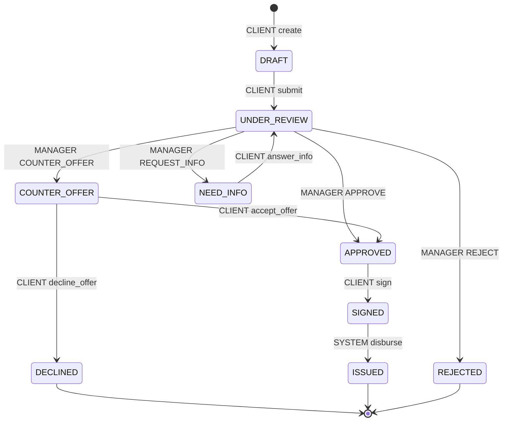

# Статусы заявки (FSM)

<!-- Генерируется `make state-machine` из app/applications/fsm.py. Не редактировать вручную. -->

Статус меняется только через `transition()`. Каждый переход пишет событие в `application_events` и увеличивает `revision`. Любой переход не из таблицы — `409 INVALID_STATUS_TRANSITION`.

| Из | Действие | Кто | В |
| --- | --- | --- | --- |
| — | `create` | CLIENT | `DRAFT` |
| `DRAFT` | `submit` | CLIENT | `UNDER_REVIEW` |
| `UNDER_REVIEW` | `APPROVE` | MANAGER | `APPROVED` |
| `UNDER_REVIEW` | `REJECT` | MANAGER | `REJECTED` |
| `UNDER_REVIEW` | `COUNTER_OFFER` | MANAGER | `COUNTER_OFFER` |
| `UNDER_REVIEW` | `REQUEST_INFO` | MANAGER | `NEED_INFO` |
| `NEED_INFO` | `answer_info` | CLIENT | `UNDER_REVIEW` |
| `COUNTER_OFFER` | `accept_offer` | CLIENT | `APPROVED` |
| `COUNTER_OFFER` | `decline_offer` | CLIENT | `DECLINED` |
| `APPROVED` | `sign` | CLIENT | `SIGNED` |
| `SIGNED` | `disburse` | SYSTEM | `ISSUED` |

